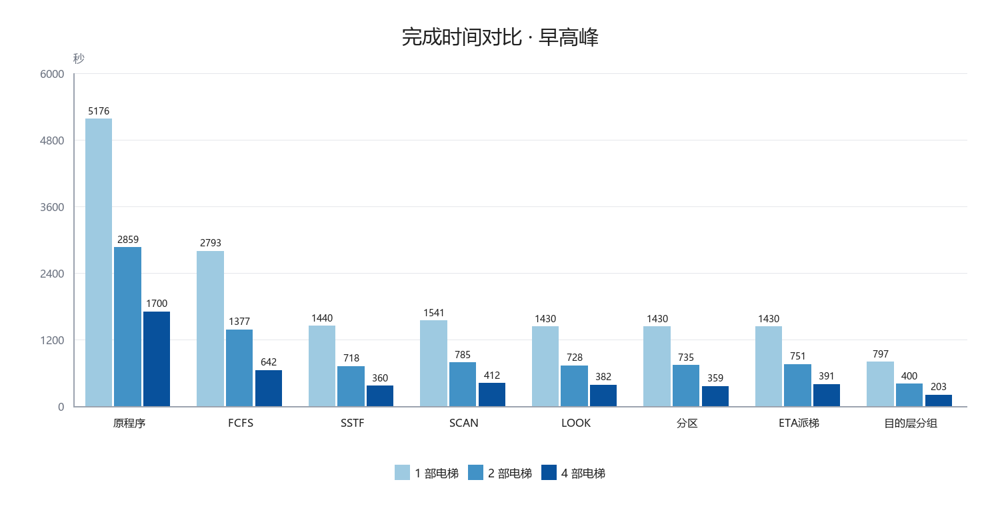
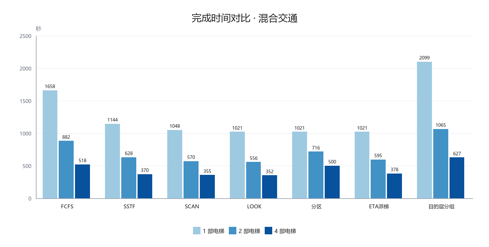

# 电梯调度仿真：从 20 层到 100 层，哪种调度算法最快？



把原来那个「每层都开门」的小练习，改造成一个**带时间模型、可比较调度策略**的仿真器。
小场景 100 名乘客 / 20 层楼，摩天楼场景 200 名乘客 / 100 层楼，每部电梯载 8 人。
一共八种需求形态：

| 场景 | 需求形态 | 冠军 | 成绩 |
|---|---|---|---|
| **A 早高峰** | 100 人全在 1 楼，目的地 2~20 层随机 | 目的层分组 | 1 部梯 797 s；4 部梯 203 s |
| **B 混合交通** | 起点、终点都在全楼随机（≠本层），全部同时候梯 | **LOOK 顺向截梯** | 1 部梯 1021 s；4 部梯 352 s |
| **C 动态混合** | 100 人在 0~180 s 内陆续到达，起点终点全楼随机 | **LOOK 顺向截梯** | 1 部梯 980 s；4 部梯 326 s |
| **E 摩天楼早高峰** | 100 层、200 人全在 1 楼、电梯 4 倍速 | 目的层分组 | 1 部 2131 s；4 部 547 s |
| **F 摩天楼混合** | 100 层、200 人起点终点全楼随机 | **LOOK / SSTF** | 1 部 3477 s；4 部 1034 s |
| **G 摩天楼动态** | 100 层、200 人分 0~360 s 到达 | **LOOK 顺向截梯** | 1 部 3375 s；4 部 972 s |
| **D 无限客流** | 4 部梯，每秒来 n 人，跑 7200 s，单层积压 >40 判超载 | **LOOK / SCAN / SSTF / ETA** | 容量 0.4 人/秒 ≈ 1440 人/小时 |
| **H 摩天楼无限客流** | 100 层 / 4 倍速 / 14400 s，n=1/3~0.125 | **SSTF** | 体面运力 0.25 人/秒 ≈ 900 人/小时 |

> A 场景的冠军「目的层分组」**要求乘客在进电梯前就表达目的层**（每层 20 按钮 / 触摸屏）。
> 只用上/下两个按钮时它根本无法实现，早高峰最好也只能到 LOOK 的 1430 s —— 详见第 11 节。

前三个场景的冠军**不是同一个**：A 场景里「目的层分组」比 LOOK 快 1.8 倍；
到了 B 场景它反而比 LOOK **慢一倍**（2099 s vs 1021 s）；C 场景它更是垫底（2020 s）。

另外还有一个更根本的变量：**乘客怎么表达需求**。只用上/下按钮时，
系统根本不知道乘客要去哪——那「目的层分组」「ETA 派梯」就无从谈起，
「目的层分区」也只能靠乘客自己挑车。本文累计 2175 次仿真把这几件事都量化了
（见第 11 节）。

完整数据：[report.md](report.md)（早高峰）、[report_uniform.md](report_uniform.md)（混合交通）、
[report_lobby_hall.md](report_lobby_hall.md) / [report_uniform_hall.md](report_uniform_hall.md)（只有按钮）。

---

## 1. 场景定义

| 参数 | 值 |
|---|---|
| 楼层 | 1 ~ 20 层（1 楼是大堂） |
| 电梯数量 | 1 / 2 / 4（初始都在 1 楼） |
| 电梯容量 | 8 人 |
| 乘客 | 100 人，`t=0` 就全部在候梯 |
| 场景 A 起点 | 全部在 1 楼；目的地 `random(2..20)` |
| 场景 B 起点 | 每人在 `random(1..20)` 层；目的地是**除本层外**的随机楼层 |
| 场景 C 起点 | 同 B；到达时刻 `random(0..180)` 秒，整数、含两端 |
| 场景 D 到达 | 每秒 `n` 人（可取小数），直到 7200 s 冻结；4 部梯，初始停在随机楼层 |
| 场景 D 判定 | 任一层候梯 >40 人即该次失败；5 个种子里失败 ≥3 次视为扛不住 |
| 场景 E/F/G | 同上三个场景，但换成 **100 层楼、200 人、电梯 4 倍速**（G 的到达窗口 0~360 s） |
| 场景 H | 同 D，但 **100 层、4 倍速、14400 s**，n = 1/3 / 0.25 / 0.2 / 0.125 人/秒 |
| 停靠规则 | **只停有人的楼层**（原程序每层都停，已淘汰） |
| 乘客身份 | 只用工号 `pid`，不再用人名 |

## 2. 时间模型（按你的体感数据）

| 项目 | 秒 |
|---|---|
| 全速通过一层 | 1 |
| 起步 → 停稳（含第一层位移） | 4（即 1→2 用 4 s） |
| 跨越 n 层（n≥2） | 4 + n（1→3 用 6 s，1→4 用 7 s，20 层直达 24 s） |
| 开门 / 关门 | 各 2 |
| 上下客 | 每人 1 s，最少 2 s |

于是**一次停靠**的成本 = `开门 2 + max(2, 上下客人数) + 关门 2`，
有人上下时最少 6 s，停 8 个人要 12 s。这也是为什么「少停一层」比「快开一层」值钱。

对应代码在 [`sim/model.py`](sim/model.py) 的 `Timing` 类，改几个数字就能换一套体感：

```python
def travel(self, floors):
    return self.start_stop if floors == 1 else self.start_stop + floors * self.floor_time
```

> 注：你给的三个观测点（4 / 6 / 7 秒）不是一条直线——第二层跳了 2 秒，之后每层 +1 秒。
> 我按「第一层 4 s，之后 n 层 = 4+n」拟合并让三个点全部吻合。若你本意的曲线不同
> （比如 1→3 想用 5 s），只需要改 `Timing.travel()` 这一个方法，其余模型不受影响。

## 3. 八种调度算法

> 原程序「每层必停」按需求淘汰了，早高峰报告里仍保留它当基线。

| key | 算法 | 一句话 | 看方向? | 需要目的层? |
|---|---|---|---|---|
| `fcfs` | 先来先服务 | 严格按请求先后接送，目的地随机时在楼层间来回折返 | ✗ | ✗ |
| `sstf` | 最近优先 | 每次跑向离自己最近的请求（磁盘磁头调度那套） | ✗ | ✗ |
| `scan` | 扫描（SCAN） | 保持方向走到底再回头，前方没请求也空驶到端点 | ✓ | ✗ |
| `look` | 顺向截梯（LOOK） | 前方没有请求就立刻换向，不空驶 | ✓ | ✗ |
| `zoning` | 目的层分区 | 把 2~20 层切成 n 段，每辆车只把乘客送到自己区里 | ✓ | ✓ |
| `zoning_call` | 呼叫分区 | 只有按钮时的分区：每辆车只响应自己那几层的呼叫 | ✓ | ✗ |
| `dd_eta` | 目的层派梯（ETA 均分） | 按各车工作量把乘客平均分下去，车按 LOOK 执行 | ✓ | ✓ |
| `dd_group` | 目的层分组 | 把目的地相近的乘客凑成一车，一趟只停相邻 2~3 层 | ✓ | ✓ |

「需要目的层」的意思见第 11 节：只有上/下按钮时，带 ✓ 的三种算法无法实现（或只能退化实现）。

上客规则：

* **空车谁都能上**，并按第一位上车乘客的方向决定行驶方向；
* 车厢里有乘客时，**只接同方向**的候梯者（顺向截梯）——**FCFS / SSTF 例外**，
  这两个策略本来就不区分方向，所以它们到站就接人。

## 4. 怎么跑

```bash
cd 40_Python/20240117_elevators

python elevators.py                                     # 默认：2 部电梯 + LOOK + 早高峰
python elevators.py --scenario uniform                  # 混合交通
python elevators.py --scenario dynamic                  # 动态混合（乘客陆续到达）
python elevators.py --scenario lobby100 --cars 4        # 100 层摩天楼早高峰
python elevators.py --info hall --scenario uniform      # 只有上/下按钮
python elevators.py --algo dd_group --cars 4 --scenario uniform
python elevators.py --algo look --cars 2 --trace        # 打印逐秒事件流
python elevators.py --list                              # 看所有算法
python elevators.py --check                             # 自检（场景 × 信息模型 × 全部算法）
python elevators.py --bench                             # 跑分：默认早高峰 + 目的地已知
python elevators.py --bench --scenario all --info both  # 十二个组合全跑，刷新十二份报告
python elevators.py --ladder                            # 场景 D：容量阶梯（4 部电梯）
python elevators.py --ladder --info hall                # 场景 D：只有按钮
python elevators.py --ladder100                         # 场景 H：100 层容量阶梯
python elevators.py --ladder100 --info hall             # 场景 H：只有按钮
```

`--trace` 输出的样子（12 人、1 部梯、目的层分组）：

```
[t=   0] 1号梯 在1F 开门
[t=   2] 1号梯 1F 上8人 / 下0人，车内8人（8s）
[t=  12] 1号梯 1F→4F 发车，3层约7s
[t=  19] 1号梯 到达4F
[t=  21] 1号梯 4F 上0人 / 下1人，车内7人（2s）
```

## 5. 场景 A（早高峰）结果：完成时间（秒，5 个种子均值）

| 算法 | 1 部电梯 | 2 部电梯 | 4 部电梯 |
|---|---:|---:|---:|
| 原程序（每层必停） | 5176 | 2859 | 1700 |
| FCFS（先来先服务） | 2793 | 1377 | 642 |
| SSTF（最近优先） | 1440 | 718 | 360 |
| SCAN（扫描） | 1541 | 785 | 412 |
| LOOK（顺向截梯） | 1430 | 728 | 382 |
| 目的层分区 | 1430 | 735 | **359** |
| 目的层派梯（ETA 均分） | 1430 | 751 | 391 |
| **目的层分组** | **797** | **400** | **203** |

平均门到门耗时（秒）：

| 算法 | 1 部电梯 | 2 部电梯 | 4 部电梯 |
|---|---:|---:|---:|
| 原程序 | 2712 | 1507 | 904 |
| FCFS | 1440 | 725 | 347 |
| LOOK | 711 | 356 | 178 |
| 目的层分区 | 711 | 323 | 140 |
| 目的层分组 | **370** | **189** | **99** |

## 6. 场景 A 解读

### 6.1 原程序为什么慢 3.6 倍

100 人 ÷ 8 人 = 13 趟。原程序每趟不管有没有人都要开 20 次门，而且一层一层挪（每层 4 s）：
一次停靠至少 6 s，上行 20 层就是 `20×4 + 20×6 = 200 s`；到顶后还得空车往下扫一遍，
又是 200 s。**来回 400 s，其中一半是空车返程**。13 趟 ≈ 5200 s —— 与实测 5176 s 完全对得上。
它的平均**乘梯**时间其实很短（104 s），因为上楼途中不停留；但**候梯**时间高达 2608 s，
全耗在排队和空开门上。

跳层之后，同一部电梯的停靠次数从 510 次降到 96 次，才有 1430 s 这个成绩。

### 6.2 「跳层 + 正确换向」就是及格线

原程序的换向逻辑有两个毛病：① 每层必停；② 第 0 轮在乘客状态还没初始化时就判断换向，
凭空把方向改成 Down，白等一轮（新版把「终层强制换向 + 先更新状态再决策」做对了）。
修完之后 LOOK 只要 1430 s，是原程序的 1/3.6。

**时间到底花在哪？** 以「2 部梯 + LOOK」为例，全程 728 s，每部梯约 317 s（44%）
花在开关门和等乘客上下，约 380 s（52%）在楼层间移动。也就是说，
**减少一次停靠 ≈ 省 6~12 s，比把电机开快一点也不差** —— 这正是跳层和目的层分组最值钱的原因。

### 6.3 FCFS 差在「来回跑」

FCFS 的停靠次数并不算多（139 次），但**运行层数 1399 层**，是 LOOK（433 层）的 3.2 倍：
它按请求顺序送人，上一单去 18 楼、下一单去 3 楼，车就在楼里来回横跳。
这说明「少停」和「少跑」是两件事，能耗看的是后者。

### 6.4 SSTF 单梯吃亏、多梯反超

最近优先在一部梯时略输 LOOK（1440 vs 1430），因为它偶尔会为了近处的请求掉头。
但 4 部梯时它 360 s 反超 LOOK 的 382 s：车多了以后，就近服务天然把 4 部车摊开，
反而减少了扎堆。SCAN 则稳定垫底于 LOOK——它每次都要空驶到端点（4 部梯时跑了 552 层，比 LOOK 多 36%）。

### 6.5 分区：最省电，但不一定最快

分区让每部车只服务固定的目的楼层段，4 部梯时停靠只有 **68 次**、运行 **296 层**（LOOK 是 97 次 / 407 层），
平均门到门 140 s 也是经典算法里最好的。代价是刚性：某区人多、某区人少时无法互相帮忙，
所以完成时间（359 s）只比 LOOK 好一点点。

### 6.6 ETA 均分：静态分配的「尾程陷阱」

把 100 人平均分给 4 部车，每车 25 人 → 3 趟满载 + 1 趟只载 1 人。
多出来的 3 趟「一人专车」要跑完全程，于是 391 s，反而输给不分配、谁空谁拉的 LOOK（382 s）。
**这告诉我们：派梯算法真正的难点不是分配，而是处理最后那几个零散乘客。**

### 6.7 目的层分组：早高峰的最优解

既然 100 人都还没上车，就先把他们**按目的层排序**，每 8 人一批分给各车：

* 每批 8 人只落在相邻 1~2 层，一趟只停 **2~3 次**（LOOK 要停 7~8 次）；
* 每趟往返约 **60 s**（LOOK 约 110 s），4 部梯全程只跑 224 层（LOOK 407 层）；
* 所以 4 部梯 203 s 就送完，比原程序快 **8.4 倍**。

### 6.8 加电梯的边际收益

| 算法 | 1 部 | 2 部 | 4 部 | 1→2 | 2→4 |
|---|---:|---:|---:|---:|---:|
| LOOK | 1430 | 728 | 382 | 1.96× | 1.91× |
| 目的层分组 | 797 | 400 | 203 | 1.99× | 1.97× |
| 原程序 | 5176 | 2859 | 1700 | 1.81× | 1.68× |

电梯数量基本是线性收益（瓶颈是每趟的固定开销），但**原程序的增益明显更差**：
4 部梯一起扫楼会互相挡路，1700 s 甚至慢于「1 部梯 + LOOK」的 1430 s。

---

## 7. 场景 B（混合交通）结果



完成时间（秒，5 个种子均值）：

| 算法 | 1 部电梯 | 2 部电梯 | 4 部电梯 |
|---|---:|---:|---:|
| FCFS（先来先服务） | 1658 | 882 | 518 |
| SSTF（最近优先） | 1144 | 628 | 370 |
| SCAN（扫描） | 1048 | 570 | 355 |
| **LOOK（顺向截梯）** | **1021** | **556** | **352** |
| 目的层分区 | 1021 | 716 | 500 |
| 目的层派梯（ETA 均分） | 1021 | 595 | 378 |
| 目的层分组 | 2099 | 1065 | 627 |

平均门到门耗时（秒）：

| 算法 | 1 部电梯 | 2 部电梯 | 4 部电梯 |
|---|---:|---:|---:|
| FCFS | 802 | 439 | 287 |
| SSTF | 548 | 305 | 198 |
| SCAN | 486 | 277 | 189 |
| **LOOK** | **481** | **275** | **188** |
| 目的层分区 | 481 | 291 | 196 |
| 目的层派梯（ETA 均分） | 481 | 283 | 188 |
| 目的层分组 | 1088 | 548 | 300 |

## 8. 场景 B 解读

### 8.1 LOOK 全胜：1 / 2 / 4 部梯都是第一或并列第一

混合交通的请求是**双向、分散**的，这恰好是 LOOK 的主场：每层都可能有人，
车一路扫过去就能顺路接人，几乎不空跑——4 部梯只跑了 224 层，是所有算法里最少的。
单梯 1021 s，是 FCFS 的 0.62 倍、目的层分组的 0.49 倍。

### 8.2 目的层分组从冠军跌到倒数第一

它的批处理假设「所有人在同一层等车」：8 人一批、目的地相邻，一趟只停 2~3 层。
但在混合交通里，这 8 个人的**起点散布在 8 个楼层**，车必须先绕全楼把人收齐
（全程 775 层，是 LOOK 的 3.5 倍），再把人送到相邻的 2~3 层。
省下来的「送达停靠」被「接人停靠」加倍吃回去了：

| | LOOK | 目的层分组 |
|---|---:|---:|
| 完成时间（4 部梯） | 352 | 627 |
| 运行层数 | 224 | 775 |
| 停靠次数 | 115 | 147 |
| 平均候梯 | 134 | 268 |

**结论：目的层分组是早高峰专用武器，不能无脑上。**

### 8.3 目的层分区也崩了：500 s vs 352 s

分区按**目的层**划片：车只把乘客送到自己区里。早高峰时这很聪明（大家都在 1 楼，
接人零成本）；混合交通下，乘客散在全楼，车得穿楼去接人——运行 496 层，是 LOOK 的 2.2 倍。
有趣的是它的**乘梯时间反而最短**（32 s，LOOK 54 s），因为乘客在区内送达；
但完成时间崩了 42%。**省电和快，不是一回事。**

### 8.4 FCFS 依旧最差

1658 / 882 / 518，运行层数 661~778 层。不看方向 + 按请求顺序 = 在楼里画折线，
单梯时比 LOOK 慢 62%。它的乘梯时间（121 s）也是最长——因为乘客跟着车绕路。

### 8.5 车多了以后大家趋同

4 部梯时：LOOK 352、SCAN 355、SSTF 370、ETA 378，差距只有 8%。
原因是 100 个请求散布全楼，每部车总能就近找到活干，**调度策略的差异被运力瓶颈掩盖了**。
但 1 部梯时差距是 2 倍（1021 vs 2099）——车越少，算法越重要。

### 8.6 一个反直觉的发现

混合交通的完成时间反而比早高峰**更低**（4 部梯 LOOK：352 s vs 382 s），
因为平均行程短（约 6.7 层，早高峰平均 10 层）。
但平均候梯时间差不多（134 s vs 131 s），乘梯时间更长（54 s vs 46 s）。
换句话说：**早高峰是"上楼慢"，混合交通是"等车久、坐得久"。**

## 9. 场景 C（动态混合交通）结果

前两个场景都是"100 人同时到齐"。真实楼宇不是这样：乘客是陆续来的。
场景 C 让 100 人在 **0~180 s 内均匀随机到达**（整数秒，含两端）：
每秒钟开始时新乘客进场、按完按钮，**然后**电梯才动作；
起点和目的地全楼随机，电梯初始在 1 楼。

完成时间（秒，5 个种子均值）：

| 算法 | 1 部电梯 | 2 部电梯 | 4 部电梯 |
|---|---:|---:|---:|
| FCFS（先来先服务） | 1455 | 800 | 447 |
| SSTF（最近优先） | 1039 | 558 | 363 |
| SCAN（扫描） | 1004 | 530 | 341 |
| **LOOK（顺向截梯）** | **980** | **524** | **326** |
| 目的层分区 | 980 | 773 | 575 |
| 目的层派梯（ETA 均分） | 980 | 552 | 370 |
| 目的层分组 | 2020 | 981 | 529 |

平均门到门耗时（秒）：

| 算法 | 1 部电梯 | 2 部电梯 | 4 部电梯 |
|---|---:|---:|---:|
| FCFS | 720 | 417 | 259 |
| SSTF | 497 | 256 | 166 |
| SCAN | 437 | 230 | 143 |
| **LOOK** | **435** | **229** | **141** |
| 目的层分区 | 435 | 271 | 186 |
| 目的层派梯（ETA 均分） | 435 | 243 | 152 |
| 目的层分组 | 941 | 450 | 211 |

### 9.1 LOOK 又赢了，SCAN 咬得很紧

LOOK 980 / 524 / 326，SCAN 只慢 2.4% / 1.1% / 4.6%。
客流稀疏时顺向截梯几乎是"每层都能顺路带人"：4 部梯只跑 **270 层**、
停靠 128 次，是全部算法里最少的。FCFS 依旧垫底（1455 / 800 / 447，跑了 929 层）。

### 9.2 目的层分组塌了：凑批依赖"积压"

目的层分组是 LOOK 的 2.1 / 1.9 / 1.6 倍（2020 / 981 / 529）。
原因很直白：平均只有 **0.55 人/秒** 到达，装车时往往只有一两个人，
"凑不满的批"让车绕遍全楼去接散客——4 部梯跑了 **679 层**（LOOK 270 层）、
停靠 154 次，却换不来"一趟少停几层"的好处。平均候梯也从 89 s 涨到 178 s。

**目的层分组只适合"大堂积压了一批人"的早高峰，客流一稀就变成负担。**

### 9.3 动态场景的完成时间反而更短，但不是"更容易"

326 s < 混合交通的 352 s，因为不用在 t=0 一次吞下 100 人；
但这是"摊薄"的结果：大部分时间系统只有零星几个人，**调度智能没有发挥空间**。
真正的压力集中在最后一段——最后一位乘客大约 180 s 到达，326 s 送完，
即"收尾"仍要 146 s。

### 9.4 按钮模式下（详见第 11 节）

LOOK 仍是 980 / 524 / 326；"见呼叫就停"的目的层分区掉到 980 / 1080 / **988**
（4 部梯停靠 377 次、运行 793 层）；按楼层呼叫分区是 980 / 695 / 420。

### 9.5 小结

* **客流越稀，越该用简单算法**：没有积压，目的层分组/派梯的收益被"空跑"吃掉。
* 前三个场景里 LOOK 都是冠军或并列冠军——它是这套实验里唯一"从不掉队"的策略。

## 10. 场景 D（无限客流）：人均交通时间与容量上限

前三个场景都是"运完 100 人就结束"。场景 D 反过来：**客流无限**，
4 部电梯（初始停在随机楼层），每秒平均来 n 人，连续跑 **7200 s** 后冻结，
没送到的乘客直接剔除，只看**人均交通时间**（按下按钮 → 走出电梯）。
**任一层候梯 >40 人**判本次失败；每个 n 跑 5 个种子，**失败 ≥3 次**才算扛不住。

### 10.1 先说结论：n=1 就已经超载了

表里是"撑到超载"的秒数：

| 算法 | n=1 | n=2 | n=4 | n=8 | n=16 |
|---|---:|---:|---:|---:|---:|
| FCFS | 749 | 358 | 160 | 76 | 39 |
| SSTF | 857 | 378 | 173 | 78 | 40 |
| SCAN | 876 | 378 | 166 | 79 | 39 |
| **LOOK** | **868** | **392** | **170** | **79** | **39** |
| 目的层分区 | 784 | 386 | 166 | 80 | 40 |
| ETA 派梯 | 874 | 377 | 176 | 79 | 40 |
| 目的层分组 | 788 | 342 | 156 | 77 | 40 |

35 个组合（7 种算法 × 5 档 n）全灭。原因：4 部电梯的运力大约 **0.4 人/秒 ≈ 1440 人/小时**，
而 n=1 就是 3600 人/小时——**2.5 倍**。所以这个阶梯整体落在"超载区"，
只能比谁撑得久。

### 10.2 把阶梯调到 0.5 人/秒以下，分界线才出来

人均交通时间（秒），`失败5/5` 表示 5 个种子都被判定超载：

| 算法 | 0.5 | 0.4 | 0.33 | 0.25 | 0.2 | 0.125 |
|---|---:|---:|---:|---:|---:|---:|
| FCFS | 失败5/5 | 失败5/5 | 624 | 229 | 196 | 160 |
| SSTF | 失败5/5 | 306 | 167 | 130 | 115 | 76 |
| SCAN | 失败5/5 | 213 | 143 | 109 | 80 | 52 |
| **LOOK** | 失败5/5 | **208** | **144** | **102** | **78** | **47** |
| 目的层分区 | 失败5/5 | 失败5/5 | 失败5/5 | 失败5/5 | 211 | 75 |
| ETA 派梯 | 失败5/5 | 350 | 217 | 151 | 112 | 42 |
| 目的层分组 | 失败5/5 | 失败5/5 | 失败5/5 | 205 | 186 | 46 |

### 10.3 容量上限（失败 ≤2/5）

| 算法 | 最大可持续速率 | 折算 |
|---|---:|---:|
| **LOOK / SCAN / SSTF / ETA** | **0.4 人/秒** | **1440 人/小时** |
| FCFS | 0.33 人/秒 | 1188 人/小时 |
| 目的层分组 | 0.25 人/秒 | 900 人/小时 |
| 目的层分区 | 0.2 人/秒 | 720 人/小时 |

### 10.4 怎么读这些数

1. **容量和"体验"是两回事**。FCFS 容量 0.33 排第二，但它在 0.33 时人均 624 s——
   靠"乘客等很久"换吞吐；LOOK 在 0.4 时人均才 208 s。
2. **接近饱和时，简单算法反而最稳**：0.4 人/秒时 LOOK 208 s、SCAN 213 s，
   而 ETA 350 s、FCFS 直接崩。堵起来以后，能顺路捎人、少绕路的策略才活得下来。
3. **低负载时"聪明算法"有小幅优势**：0.125 人/秒时 ETA 42 s、目的层分组 46 s，
   略好于 LOOK 47 s——但它们经不起堵（分组在 0.25 时只送完 78%）。
4. **目的层分区最怕堵**（0.2 人/秒，720 人/小时）：车被钉在固定楼层段，
   乘客一多就得满楼跑去接人。
5. **按钮模式**：LOOK 容量不变（0.4 人/秒），但"盲停"的分区掉到 0.125（450 人/小时），
   连低负载下的人均时间都从 75 s 涨到 450 s。

### 10.5 小结

4 部电梯的真实容量大约 **1400 人/小时**（0.4 人/秒）。你给的 n=1 已经是运力的 2.5 倍，
阶梯要往 0.5 以下调才有区分度。容量上限最高的是 LOOK / SCAN / SSTF / ETA；
如果还要看乘客体验，LOOK 在接近饱和时也是最好的。

### 10.6 摩天楼版（场景 H）：100 层 / 4 倍速 / 14400 s

同 D，但换成 100 层、4 倍速、跑 14400 s，n 取 1/3、0.25、0.2、0.125 人/秒。

**人均交通时间（秒）**

| 算法 | 1/3 | 0.25 | 0.2 | 0.125 |
|---|---:|---:|---:|---:|
| FCFS | 2903 | 1931 | 1234 | 687 |
| SSTF | 1399 | 694 | 353 | 189 |
| SCAN | 1275 | 805 | 446 | 114 |
| **LOOK** | **1302** | 823 | 424 | **99** |
| 目的层分区 | 失败5/5 | 467 | 446 | 299 |
| ETA 派梯 | 1450 | 967 | 505 | 105 |
| 目的层分组 | 失败3/5 | 316 | 304 | 128 |

**两种容量口径**

| 算法 | 超载线（失败 ≤2/5） | 体面运力（完成率 ≥90%） |
|---|---|---|
| SSTF | 1/3 | **0.25（900 人/小时）** |
| SCAN / LOOK / ETA | 1/3 | 0.2（720 人/小时） |
| FCFS | 1/3 | 0.125（450 人/小时） |
| 目的层分区 / 目的层分组 | 0.25 | 0.125（450 人/小时） |

**怎么读：**

1. **"单层 40 人"这个判据在 100 层楼里太宽松**。需求摊在 100 层上，
   1/3 人/秒时 LOOK 只送走 **73%**，却一次都没触发超载。所以我补了第二列
   "完成率 ≥90% 的体面运力"——这才是真实的运力边界。
2. **体面运力**：SSTF 0.25 最高（900 人/小时），LOOK/SCAN/ETA 0.2（720 人/小时），
   其余 0.125（450 人/小时）。100 层比 20 层的 0.4 人/秒低了整整一半——
   楼更高、行程更长，4 倍速也补不回来。
3. **低负载比体验**：0.125 人/秒时 LOOK 99 s 最好（ETA 105、SCAN 114、分组 128、SSTF 189、FCFS 687）。
4. **中负载要小心"平均值的陷阱"**：0.25 人/秒时目的层分组 316 s 看着最漂亮，
   但它只送完 **54%**——"剔除未送达"的指标天然奖励会丢人的策略。同负载下
   LOOK 823 s / 87%、SSTF 694 s / 94%，才是真的服务。
5. **按钮模式**：LOOK 完全不变；"盲停"分区在 0.2 时 888 s（目的地版 446 s），
   0.125 时 919 s 且完成率不到 90%，基本不可用；呼叫分区 0.125 时 190 s，勉强能用。

## 11. 需求表达方式会不会改变结论？


前面所有数字都默认**方法 2**。把信息模型切成**方法 1**（`--info hall`）再跑一遍，
答案分两层：**只看方向的算法一位数都不变；需要目的层的算法直接消失或退化。**

| | 方法 1 | 方法 2 |
|---|---|---|
| 硬件 | 电梯外只有 ↑ / ↓ 两个按钮 | 每层 20 个按钮，或一块触摸屏 |
| 系统知道什么 | 某层有人要上行 / 下行 | 每个人要去哪一层 |
| 命令行 | `--info hall` | `--info destination`（默认） |

### 11.1 哪些算法还能用

| 算法 | 方法 1（按钮） | 方法 2（目的地） | 结果会变吗 |
|---|---|---|---|
| FCFS / SSTF / SCAN / LOOK | ✅ | ✅ | **完全不变**（逐位相同） |
| `zoning` 目的层分区 | ⚠️ 只能"白停 + 乘客自选" | ✅ 精确 | 混合交通下明显变差 |
| `zoning_call` 呼叫分区 | ✅ | — | 方法 1 专属 |
| `dd_eta` ETA 派梯 | ❌ 无法实现 | ✅ | — |
| `dd_group` 目的层分组 | ❌ 无法实现 | ✅ | — |

原因很直接：

* FCFS / SSTF / SCAN / LOOK 从不使用候梯者的目的地，只用"哪层有人、朝哪边"——
  **这类算法对信息模型免疫**（实测跑出来一个数都不差）。
* 分区在按钮世界里，车不知道该接谁：呼叫一来就得停，然后靠乘客自己挑上哪辆车。
  每次"白停"至少 6 s（开门 2 + 最少 2 s 上下客 + 关门 2）。
* 分组和派梯都必须**在乘客上车前就知道目的地**（凑批、算 ETA 都要），
  只有两个按钮时在物理上就不存在。

### 11.2 混合交通实测（完成时间，1 / 2 / 4 部电梯）

| 算法 | 方法 2（目的地已知） | 方法 1（只有按钮） |
|---|---|---:|
| FCFS | 1658 / 882 / 518 | 1658 / 882 / 518 |
| SSTF | 1144 / 628 / 370 | 1144 / 628 / 370 |
| SCAN | 1048 / 570 / 355 | 1048 / 570 / 355 |
| **LOOK** | **1021 / 556 / 352** | **1021 / 556 / 352** |
| 目的层分区 | 1021 / 716 / 500 | 1021 / 974 / 694 |
| 呼叫分区 | 不适用 | 1021 / 763 / 480 |
| ETA 派梯 | 1021 / 595 / 378 | 无法实现 |
| 目的层分组 | 2099 / 1065 / 627 | 无法实现 |

* **LOOK 完全不变**，仍然是两个模型下的冠军。它是最"抗信息不足"的算法。
* **目的层分区在方法 1 下慢了 39%**（4 部梯 694 s vs 500 s）：
  停靠次数从 118 次涨到 **235 次**，多出来的几乎全是"停了却没人上"。
* **呼叫分区（480 s）反而略胜方法 2 的目的层分区（500 s）**：
  混合交通里乘客散在全楼，**就近接人比就近送人更值钱**。
  这也解释了为什么"按楼层分区"在只有按钮的老楼里能活下来。

动态场景（第 9 节）服从同样的规律：LOOK 的 980 / 524 / 326 **一位数不变**；
目的层分区从 575 s 掉到 **988 s**（4 部梯，停靠次数 146 → 377，运行层数 724 → 793）；
呼叫分区是 420 s。客流越稀，"白停"的浪费越致命——车会为了一个不属于自己的呼叫，
专门绕到一栋几乎没人的楼面去开门。

### 11.3 早高峰实测

| 算法 | 方法 2 | 方法 1 |
|---|---|---|
| LOOK | 1430 / 728 / 382 | 1430 / 728 / 382 |
| 目的层分区 | 1430 / 735 / 359 | 1430 / 735 / 359（几乎不变） |
| 呼叫分区 | 不适用 | 1430 / 728 / 382（退化成 LOOK） |
| ETA 派梯 | 1430 / 751 / 391 | 无法实现 |
| **目的层分组** | **797 / 400 / 203** | **无法实现** |

早高峰的呼叫全在 1 楼，所以"盲停"和"正常停"重合，分区几乎不受影响；
但**冠军「目的层分组」直接消失**——797 s 这个成绩是"乘客在进电梯前就选了楼层"换来的。
在只有按钮的世界里，早高峰最好也就到 LOOK 的 1430 / 728 / 382（4 部梯用目的层分区 359 s）。

### 11.4 小结

1. **信息模型不改变"只看方向"的算法结论**：LOOK 在两种模型下都是混合交通冠军——这也是全世界
   大多数楼至今只装两个按钮的原因。
2. **信息模型决定"能用哪些算法"**：想要早高峰 797 s 的成绩，必须让乘客进电梯前就表达目的层
   （触摸屏 / 派梯屏），这正是现代"目的层派梯"楼宇的硬件前提。
3. **分区的两种活法各有胜负**：按目的地分区在早高峰赢（359 vs 382），
   按楼层呼叫分区在混合交通赢（480 vs 500）——因为前者省的是一次送达停靠，后者省的是接人绕路。
4. **客流越稀，信息缺失的代价越大**：动态场景里盲停分区比它自己的目的地版慢 72%（988 vs 575）。

## 12. 摩天楼版（场景 E/F/G）：100 层、200 人、4 倍速

A/B/C 三个场景整体搬到 **100 层摩天楼**：200 名乘客、每场景总共 200 人（不是每层 200），
电梯最高速度 4 倍。4 倍速按 1 秒颗粒简化成分段台阶（中间不停站）：

| 跨越层数 | 1 | 2~3 | 4~7 | 8~11 | 12~15 | … | 96~99 | 100 |
|---|---|---|---|---|---|---|---|---|
| 秒 | 4 | 6 | 7 | 8 | 9 | … | 30 | 31 |

即 4 层一跳、每跳 +1 s。开关门和上下客时间不变——所以楼层"变便宜"了，
**停靠次数更值钱**。

### 12.1 E 摩天楼早高峰（200 人全在 1 楼）

| 算法 | 1 部 | 2 部 | 4 部 | 平均门到门（4 部） |
|---|---:|---:|---:|---:|
| FCFS | 8635 | 4237 | 2104 | 1130 |
| SSTF | 3810 | 1911 | 981 | 486 |
| SCAN | 4075 | 2086 | 1092 | 506 |
| LOOK | 3678 | 1885 | 986 | 464 |
| 目的层分区 | 3678 | 1886 | 975 | 401 |
| ETA 派梯 | 3678 | 1885 | 966 | 470 |
| **目的层分组** | **2131** | **1077** | **547** | **252** |

分组仍然是冠军（比 LOOK 快 1.7~1.8 倍），和 20 层版几乎一模一样（那里是 1.8 倍）。
原因：停靠成本没变，而 100 层让"8 个随机目的地"摊得更开——LOOK 一趟要停 8 次，
分组把 8 人压到相邻 2~3 层、只停 3 次。**楼越高，凑批越值钱。**

### 12.2 F 摩天楼混合交通

| 算法 | 1 部 | 2 部 | 4 部 | 平均门到门（4 部） |
|---|---:|---:|---:|---:|
| FCFS | 5431 | 2978 | 1708 | 855 |
| **SSTF** | 3545 | **1826** | **1034** | **542** |
| SCAN | 3681 | 1889 | 1151 | 574 |
| LOOK | **3477** | 1846 | 1104 | 558 |
| 目的层分区 | 3477 | 2650 | 1715 | 608 |
| ETA 派梯 | 3477 | 1952 | 1089 | 549 |
| 目的层分组 | 5826 | 3036 | 1679 | 790 |

有个变化：**4 部电梯时 SSTF 反超了 LOOK**（1034 vs 1104），2 部时也略胜（1826 vs 1846）。
100 层、200 人、请求散得很开，就近服务把 4 部车摊得比顺向截梯更均匀。
但它俩只差 6%，而且 LOOK 在 1 部电梯时仍是第一（3477 vs 3545）。

### 12.3 G 摩天楼动态混合（0~360 s 到达）

| 算法 | 1 部 | 2 部 | 4 部 | 平均门到门（4 部） |
|---|---:|---:|---:|---:|
| FCFS | 5251 | 2640 | 1492 | 783 |
| SSTF | 3378 | 1800 | 1031 | 463 |
| SCAN | 3474 | 1822 | 976 | 389 |
| **LOOK** | **3375** | **1769** | **972** | **383** |
| 目的层分区 | 3375 | 2594 | 1767 | 556 |
| ETA 派梯 | 3375 | 1842 | 1068 | 422 |
| 目的层分组 | 5623 | 2855 | 1430 | 587 |

LOOK 与 SCAN 几乎并列（972 vs 976）。分组和分区继续垫底——
客流一稀，"凑批"和"划片"都变成绕路。

### 12.4 按钮模式：100 层把信息缺失的代价放大了

| 场景 | 4 部梯 LOOK | 4 部梯 盲停分区 | 4 部梯 呼叫分区 |
|---|---:|---:|---:|
| E 早高峰 | 986 | 975 | 986（退化成 LOOK） |
| F 混合 | 1104 | **6486** | 1399 |
| G 动态 | 972 | **7996** | 1333 |

早高峰只有一个呼叫楼层，盲停和正常停重合，分区几乎不受影响；
但混合/动态下，**盲停分区是 LOOK 的 6~8 倍**（20 层时只有 2~3 倍）。
原因：100 层楼每层都可能有人按按钮，车为了一个不属于自己的呼叫，要横穿几十层去开门，
到了却发现没人能上。

### 12.5 小结

* **楼高不改变排名，只放大差距**：早高峰仍是分组赢（1.8 倍），混合/动态仍是 LOOK
  （SSTF 在 4 部梯时以 6% 的优势紧咬）——和 20 层版结论一致。
* 4 倍速让楼层变便宜、停靠相对更贵，所以"少停几次"的策略（分组、LOOK）收益更大。
* 信息模型的影响随楼高显著放大：盲停分区从"慢 2~3 倍"恶化到"慢 6~8 倍"。

## 13. 八个场景放一起看

### 13.1 20 层版（A/B/C）

| | A 早高峰（全在 1 楼） | B 混合交通（全楼随机） | C 动态混合（陆续到达） |
|---|---|---|---|
| 1 部梯冠军 | 目的层分组 797 | LOOK 1021 | LOOK 980 |
| 2 部梯冠军 | 目的层分组 400 | LOOK 556 | LOOK 524 |
| 4 部梯冠军 | 目的层分组 203 | LOOK 352 | LOOK 326 |
| 最差（原程序之外） | FCFS 2793 | 目的层分组 2099 | 目的层分组 2020 |
| 最省电（4 部梯层数） | 目的层分组 224 | LOOK 224 | LOOK 265 |
| 一句话 | 需求集中在一点 → 按目的层凑批 | 需求分散 → 顺向截梯 | 需求稀疏 → 越简单越好 |

### 13.2 100 层版（E/F/G）

| | E 摩天楼早高峰 | F 摩天楼混合 | G 摩天楼动态 |
|---|---|---|---|
| 1 部梯冠军 | 目的层分组 2131 | LOOK 3477 | LOOK 3375 |
| 2 部梯冠军 | 目的层分组 1077 | SSTF 1826 | LOOK 1769 |
| 4 部梯冠军 | 目的层分组 547 | SSTF 1034 | LOOK 972 |
| 最差（原程序之外） | FCFS 8635 | 目的层分组 5826 | 目的层分组 5623 |
| 平均门到门（4 部） | 分组 252 | SSTF 542 | LOOK 383 |
| 一句话 | 楼越高，凑批越值钱 | 就近服务与顺向截梯咬得很紧 | 顺向截梯 |

**两张表一一对应**：早高峰永远是"目的层分组"赢，混合/动态永远是 LOOK（100 层时 SSTF
在 2/4 部梯以 1~6% 的优势反超）。楼高只是把绝对时间放大了约 2.6~3.4 倍，**没有改变排名**。

**场景 D / H 不在这两张表里**——它们的指标不是"多久运完"，而是"人均交通时间 + 容量上限"（见第 10 节）：
20 层时 4 部电梯 ≈ 0.4 人/秒（1440 人/小时），LOOK / SCAN / SSTF / ETA 并列最高；
100 层时体面运力降到 0.2~0.25 人/秒，SSTF 最高（900 人/小时）。

**选算法的依据是需求形态，不是算法本身的"先进程度"。**
目的层分组在早高峰把 LOOK 甩开 1.7~1.8 倍，在混合/动态场景反而被 LOOK 甩开 1.6~2 倍；
分区在早高峰省电又够快，在混合交通慢 42%、动态慢 76%（100 层时更糟）。
**真正稳健的是 LOOK：八个场景里它要么是冠军，要么只差几个百分点，一次都没掉队。**

## 14. 代码结构

```
20240117_elevators/
├── elevators.py          # 入口：单次演示 / --list / --check / --bench
├── sim/
│   ├── model.py          # 时间模型、Passenger、Elevator 状态机、World 主循环
│   ├── dispatch.py       # 8 种调度算法（只需实现 next_stop / accepts / may_board）
│   ├── benchmark.py      # 场景 × 信息模型的跑分、聚合、CSV/报告生成、自检
│   ├── capacity.py       # 场景 D：容量阶梯（无限客流 / 超载判定 / 人均交通时间）
│   └── charts.py         # 用 Pillow 画柱状图（不依赖 matplotlib）
├── report.md / results.csv                  # 早高峰 · 目的地已知（120 次）
├── report_uniform.md / results_uniform.csv  # 混合交通 · 目的地已知（105 次）
├── report_dynamic.md / results_dynamic.csv  # 动态混合 · 目的地已知（105 次）
├── report_lobby_hall.md                     # 早高峰 · 只有按钮（105 次）
├── report_uniform_hall.md                   # 混合交通 · 只有按钮（90 次）
├── report_dynamic_hall.md                   # 动态混合 · 只有按钮（90 次）
├── report_lobby100.md / results_lobby100.csv     # 100 层早高峰（105 次）
├── report_uniform100.md / results_uniform100.csv # 100 层混合交通（105 次）
├── report_dynamic100.md / results_dynamic100.csv # 100 层动态混合（105 次）
├── report_*100_hall.md                          # 上面三个的按钮版（各 90 次）
├── report_capacity.md / results_capacity.csv    # 无限客流阶梯（385 次）
├── report_capacity_hall.md                      # 无限客流 · 只有按钮（330 次）
├── report_capacity100.md / results_capacity100.csv   # 100 层容量阶梯（140 次）
├── report_capacity100_hall.md                       # 100 层 · 只有按钮（120 次）
├── charts/ charts_uniform/ charts_dynamic/ charts_hall/ ...    # 每个组合 3 张图
└── legacy/               # 保留的原始版本（每层必停 + 人名系统 + 旧日志）
```

## 15. 和原版相比修掉的问题

1. **每层必停** → 只停有人的楼层（这是最大的提速来源）；
2. **第 0 轮凭空换向** → 决策前统一刷新乘客状态，终层强制换向；
3. **人名当主键**（重名会串、`remove` 会删错人）→ 改用 `pid`；
4. **类属性当实例属性**（`m_passengers = []` 被所有实例共享）→ 全部在 `__init__` 里初始化；
5. **`Strategy_01` 靠全局名碰巧可见** → 显式的 `Dispatcher` 对象，策略可插拔；
6. **没有死锁/超时保护** → `SimulationError` + 长时间无人送达的检测；
7. **没有任何指标** → 候梯/乘梯/总时/P90/停靠次数/运行层数全套统计；
8. **打印硬编码** → 结构化事件流 + 自动生成的报告和图表。

第二轮还额外修了两个模型问题：

* **FCFS / SSTF 在混合交通下会"停在门口没人能上"**——它俩本质是不看方向的策略，
  却被"同向才上"的规则卡住了。现在上客规则由调度器决定（`may_board`），
  FCFS / SSTF 到站就接人，不再死循环。
* **信息模型被显式化**：`World.info_model` 区分"目的地已知"与"只有按钮"，
  需要目的层的算法在按钮模式下会直接报错，而不是偷偷用上不该有的信息。

## 16. 局限与可以继续玩的方向

* **到达过程是均匀分布**：场景 C 用的是 0~180 s 均匀到达，真实现场更像泊松过程，
  而且有早晚高峰曲线；目的层分组会牺牲后到乘客的等待时间。
* **没有加减速曲线**：只有「4 s 起步停稳」的集总参数；真要算功率，需要梯形速度曲线。
* **没有乘客耐心/放弃**：可以加「超过 120 s 未到就离开」来模拟真实投诉。
* **没有群控防扎堆**：4 部梯会同时被派到同一层（FCFS 尤其明显），真实群控会做「禁止同层重复响应」。
* **没有考虑电梯返回基站**：夜间/空闲时把车停回 1 楼，会改变下一次任务的启动时间。
* **场景还可以加**：上行高峰、下行高峰、层间交通（如餐厅/会议室）、双向同时高峰。

## 17. 加一个新算法

只要实现 `next_stop`（下一站停哪层）和可选的 `accepts` / `may_board`：

```python
from sim.dispatch import Dispatcher, Look

class MyDispatch(Dispatcher):
    key = "my"
    label = "我的算法"
    desc = "先接最近的同向乘客，装满了再送。"

    def next_stop(self, car, world, now):
        return Look.next_stop(self, car, world, now)   # 复用 LOOK 的路线规划

# 注册到 sim/dispatch.py 的 ALGORITHMS 列表，然后
# python elevators.py --algo my --cars 4 --scenario uniform
```


## 18. 附录：理想人均交通时间的极限

**问题**：一名乘客随机出现在某一层，目的地是另一随机层，k 部电梯初始位置各自随机。
从按下按钮 → 电梯来接 → 送达，这个时间的期望是多少？
这正是"没有任何其他乘客、没有中途停靠"时的**理论下限**。

**公式**：

```
理想 = E[travel(最近那部电梯到你所在层的距离)]
     + E[travel(起点到终点的距离)]
     + 停靠开销
```

停靠开销 = 接人（开门 2 + 上下客 2 + 关门 2 = 6 s）+ 送达（开门 2 + 上下客 2 = 4 s）= **10 s**，
与楼层数、电梯数都无关。所以电梯数量唯一影响的就是第一项——最近那部车的距离。

| 楼层 | 电梯 | 期望等车 | 期望乘梯 | 停靠开销 | **理想合计** | 平均接驾距离 | 平均行程 |
|---|---:|---:|---:|---:|---:|---:|---:|
| 20 | 1 | 10.4 | 10.9 | 10 | **31.3 s** | 6.65 层 | 7.00 层 |
| 20 | 2 | 7.6 | 10.9 | 10 | **28.5 s** | 4.15 层 | 7.00 层 |
| 20 | 4 | 5.3 | 10.9 | 10 | **26.2 s** | 2.31 层 | 7.00 层 |
| 100 | 1 | 13.9 | 14.0 | 10 | **37.9 s** | 33.33 层 | 33.67 层 |
| 100 | 2 | 10.6 | 14.0 | 10 | **34.6 s** | 20.83 层 | 33.67 层 |
| 100 | 4 | 8.2 | 14.0 | 10 | **32.2 s** | 11.66 层 | 33.67 层 |

`python elevators.py --ideal` 可复现；`sim/ideal.py` 是精确枚举，附带用仿真器做蒙特卡洛校验
（20 层 1 部：解析 31.3 s vs 仿真 31.5 s；100 层 4 部：32.2 vs 32.1）。

**五条结论**：

1. **硬下限约 21~24 s**：假设车正好停在你的楼层，"等车"为 0，只剩乘梯 + 10 s
   ——20 层 20.9 s、100 层 24.0 s。任何算法都不可能低于这个数（在单车单客模型里）。
2. **加电梯只能压缩"等车"这一段**：20 层 1→4 部，等车 10.4→5.3 s（省 5.1 s），
   合计 31.3→26.2 s（-16%）；100 层 37.9→32.2 s（-15%）。边际收益很快递减。
3. **100 层只比 20 层慢 6~7 s**：4 倍速把 5 倍的高度差基本吃掉了——
   平均行程从 7 层涨到 33.7 层，乘梯时间却只从 10.9 s 涨到 14.0 s。
4. **停靠开销占理想值的 26~38%**：10 s / 31.3 s（20 层 1 部，32%）、10 s / 26.2 s（20 层 4 部，38%）、
   10 s / 37.9 s（100 层 1 部，26%）。
   这解释了为什么"少停一层"比"跑快一点"更值钱。
5. **真实系统和这个下限还差得很远**——差距就是"共享电梯的代价"（排队、绕行、中途停靠）：

| 场景（4 部梯） | 实测人均门到门 | 理想 | 倍数 |
|---|---:|---:|---:|
| A 早高峰 20 层（分组） | 99 | 20.9 | 4.7× |
| B 混合 20 层（LOOK） | 188 | 26.2 | 7.2× |
| C 动态 20 层（LOOK） | 141 | 26.2 | 5.4× |
| E 早高峰 100 层（分组） | 252 | 24.0 | 10.5× |
| F 混合 100 层（LOOK） | 558 | 32.2 | 17.3× |
| G 动态 100 层（LOOK） | 383 | 32.2 | 11.9× |

早高峰的理想用"等车 ≈ 0"那一档（人和车都在 1 楼）。**楼越高、需求越分散，
离理想越远**——100 层混合交通是理想的 17 倍，这也是为什么高层的调度比低层难得多。
