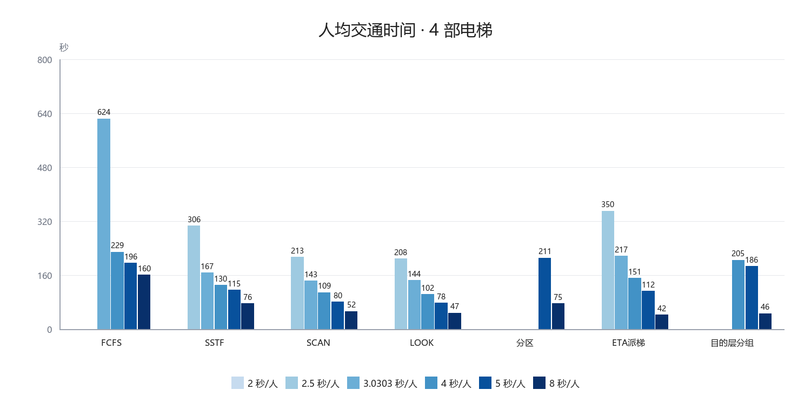
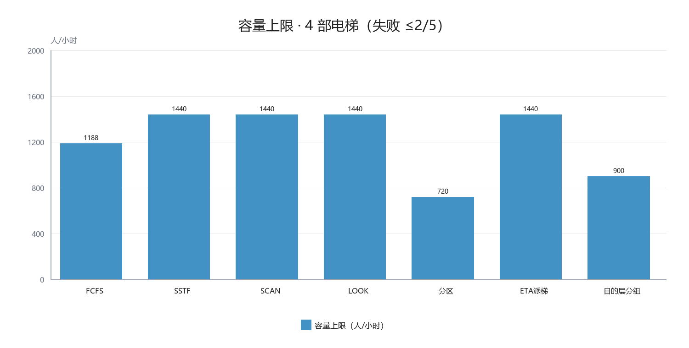

# 容量阶梯 · 4 部电梯 · 目的地已知（每层 20 个按钮 / 触摸屏）

> 自动生成于 2026-11-21 17:42:52。每秒平均刷出 n 名乘客（起点/终点全楼随机），电梯初始停在随机楼层，连续运行 **7200 s** 后冻结；只统计已经到达的乘客，指标是**人均交通时间**（按下按钮 → 走出电梯）。

**超载判定**：任一层候梯超过 40 人 → 该次模拟失败；每个 n 跑 5 个种子，失败 **≥3 次** 判定该算法扛不住这个 n。

## 一、按题目阶梯：n = 1 / 2 / 4 / 8 / 16 人每秒

结果很直接：**所有算法在 n=1 就超载了**。4 部电梯的运力约 0.4 人/秒（≈1400 人/小时），而 n=1 相当于 3600 人/小时，是运力的 2.5 倍。所以这一档只能比“谁撑得久”——表里是平均坚持到超载的秒数。

| 算法 | n=1 | n=2 | n=4 | n=8 | n=16 |
| :--- | ---: | ---: | ---: | ---: | ---: |
| FCFS（先来先服务） | 749 | 358 | 160 | 76 | 39 |
| SSTF（最近优先） | 857 | 378 | 173 | 78 | 40 |
| SCAN（扫描） | 876 | 378 | 166 | 79 | 39 |
| LOOK（顺向截梯） | 868 | 392 | 170 | 79 | 39 |
| 目的层分区 | 784 | 386 | 166 | 80 | 40 |
| 目的层派梯（ETA 均分） | 874 | 377 | 176 | 79 | 40 |
| 目的层分组 | 788 | 342 | 156 | 77 | 40 |

## 二、细分阶梯：0.5 ~ 0.125 人/秒（每 2~8 秒 1 人）

真正的容量分界线在这里。表格是**人均交通时间**（秒，越小越好），`失败 k` 表示 5 个种子里有 k 次超载。

| 算法 | 0.5 人/秒 | 0.4 人/秒 | 0.33 人/秒 | 0.25 人/秒 | 0.2 人/秒 | 0.125 人/秒 |
| :--- | ---: | ---: | ---: | ---: | ---: | ---: |
| FCFS（先来先服务） | 失败 5/5 | 失败 5/5 | 624 | 229 | 196 | 160 |
| SSTF（最近优先） | 失败 5/5 | 306 | 167 | 130 | 115 | 76 |
| SCAN（扫描） | 失败 5/5 | 213 | 143 | 109 | 80 | 52 |
| LOOK（顺向截梯） | 失败 5/5 | 208 | 144 | 102 | 78 | 47 |
| 目的层分区 | 失败 5/5 | 失败 5/5 | 失败 5/5 | 失败 5/5 | 211 | 75 |
| 目的层派梯（ETA 均分） | 失败 5/5 | 350 *1 | 217 | 151 | 112 | 42 |
| 目的层分组 | 失败 5/5 | 失败 5/5 | 失败 5/5 | 205 | 186 | 46 |

## 三、完成率

7200 s 内送到的比例。冻结时**没送到的人被剔除**，所以完成率越低，人均交通时间越“挑过”——要和这张表一起看。

| 算法 | 0.5 | 0.4 | 0.33 | 0.25 | 0.2 | 0.125 |
| :--- | ---: | ---: | ---: | ---: | ---: | ---: |
| FCFS（先来先服务） | — | — | 85% | 96% | 97% | 97% |
| SSTF（最近优先） | — | 95% | 98% | 98% | 98% | 99% |
| SCAN（扫描） | — | 96% | 98% | 98% | 99% | 99% |
| LOOK（顺向截梯） | — | 97% | 98% | 99% | 99% | 99% |
| 目的层分区 | — | — | — | — | 94% | 99% |
| 目的层派梯（ETA 均分） | — | 94% | 97% | 98% | 98% | 99% |
| 目的层分组 | — | — | — | 78% | 97% | 99% |

## 四、容量上限

规则：5 个种子里失败不超过 2 次。

| 算法 | 最大可持续到达速率 | 折算 |
| :--- | ---: | ---: |
| FCFS（先来先服务） | 0.33 人/秒 | 1188 人/小时 |
| SSTF（最近优先） | 0.4 人/秒 | 1440 人/小时 |
| SCAN（扫描） | 0.4 人/秒 | 1440 人/小时 |
| LOOK（顺向截梯） | 0.4 人/秒 | 1440 人/小时 |
| 目的层分区 | 0.2 人/秒 | 720 人/小时 |
| 目的层派梯（ETA 均分） | 0.4 人/秒 | 1440 人/小时 |
| 目的层分组 | 0.25 人/秒 | 900 人/小时 |

## 五、结论

* 容量最高的（0.4 人/秒 ≈ 1440 人/小时）：**SSTF（最近优先）、SCAN（扫描）、LOOK（顺向截梯）、目的层派梯（ETA 均分）**。
* 最低负载（0.125 人/秒）下人均交通时间最短的是 **目的层派梯（ETA 均分）**（42 s）。
* 人均交通时间随负载上升而变长：低负载时大家都差不多，接近容量上限时才拉开差距。

完整分析见 README.md。
