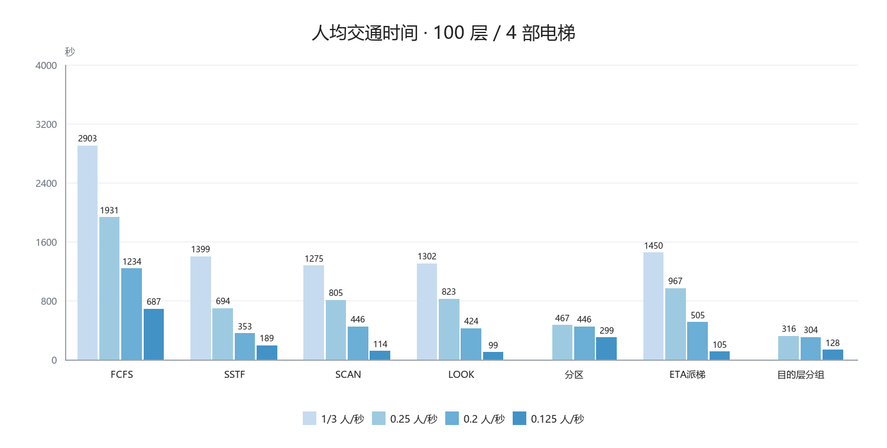
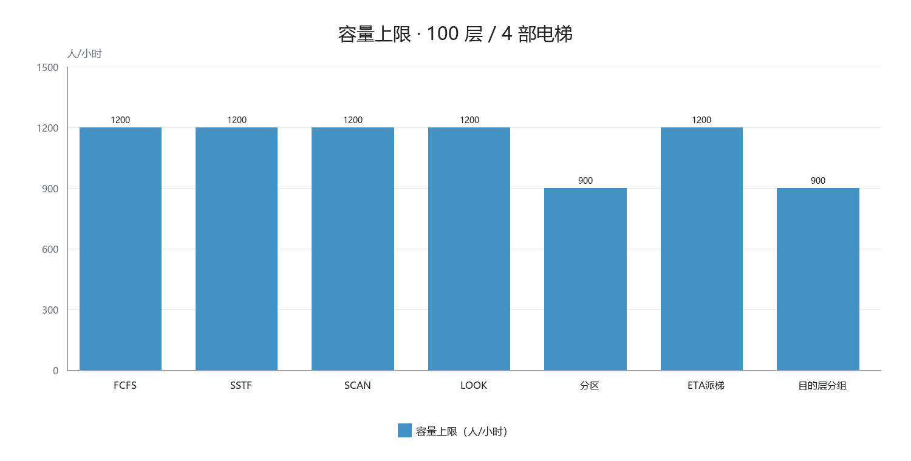

# 容量阶梯 · 摩天楼（100 层、4 倍速、4 部电梯） · 目的地已知（每层 20 个按钮 / 触摸屏）

> 自动生成于 2026-11-21 17:45:56。每秒平均刷出 n 名乘客（起点/终点全楼随机），4 部电梯初始停在随机楼层，连续运行 **14400 s** 后冻结；只统计已经到达的乘客，指标是**人均交通时间**（按下按钮 → 走出电梯）。

**超载判定**：任一层候梯超过 40 人 → 该次模拟失败；每个 n 跑 5 个种子，失败 **≥3 次** 判定该算法扛不住这个 n。

## 一、人均交通时间

单位秒，越小越好。`失败 k` 表示 5 个种子里有 k 次单层积压超过 40 人。

| 算法 | 1/3 人/秒 | 0.25 人/秒 | 0.2 人/秒 | 0.125 人/秒 |
| :--- | ---: | ---: | ---: | ---: |
| FCFS（先来先服务） | 2903 *1 | 1931 | 1234 | 687 |
| SSTF（最近优先） | 1399 | 694 | 353 | 189 |
| SCAN（扫描） | 1275 | 805 | 446 | 114 |
| LOOK（顺向截梯） | 1302 | 823 | 424 | 99 |
| 目的层分区 | 失败 5/5 | 467 *2 | 446 | 299 |
| 目的层派梯（ETA 均分） | 1450 | 967 | 505 | 105 |
| 目的层分组 | 失败 3/5 | 316 | 304 | 128 |

## 二、完成率

14400 s 内送到的比例。冻结时没送到的人被剔除，所以要和人均时间一起看。

| 算法 | 1/3 | 0.25 | 0.2 | 0.125 |
| :--- | ---: | ---: | ---: | ---: |
| FCFS（先来先服务） | 61% | 77% | 89% | 95% |
| SSTF（最近优先） | 83% | 94% | 97% | 99% |
| SCAN（扫描） | 73% | 87% | 97% | 99% |
| LOOK（顺向截梯） | 73% | 87% | 97% | 99% |
| 目的层分区 | — | 62% | 71% | 95% |
| 目的层派梯（ETA 均分） | 70% | 85% | 96% | 99% |
| 目的层分组 | — | 54% | 68% | 99% |

## 三、容量上限

规则：5 个种子里失败不超过 2 次。

| 算法 | 超载线（失败 ≤2/5） | 折算 | 体面运力（完成率 ≥90%） |
| :--- | ---: | ---: | ---: |
| FCFS（先来先服务） | 1/3 人/秒 | 1200 人/小时 | 0.125 人/秒 |
| SSTF（最近优先） | 1/3 人/秒 | 1200 人/小时 | 0.25 人/秒 |
| SCAN（扫描） | 1/3 人/秒 | 1200 人/小时 | 0.2 人/秒 |
| LOOK（顺向截梯） | 1/3 人/秒 | 1200 人/小时 | 0.2 人/秒 |
| 目的层分区 | 0.25 人/秒 | 900 人/小时 | 0.125 人/秒 |
| 目的层派梯（ETA 均分） | 1/3 人/秒 | 1200 人/小时 | 0.2 人/秒 |
| 目的层分组 | 0.25 人/秒 | 900 人/小时 | 0.125 人/秒 |

> **为什么要两列**：100 层楼里需求摊得很开，「某层积压 40 人」很难触发——1/3 人/秒时 LOOK 只送走 73%，却一次都没判超载。

## 四、结论

* 体面运力最高（完成率 ≥90%，0.25 人/秒 ≈ 900 人/小时）：**SSTF（最近优先）**。
* 超载线（失败 ≤2/5）几乎都是 1/3 人/秒（只有目的层分区/分组是 0.25），说明这个判据在 100 层楼里偏宽松，真正的差别要看完成率和人均时间。
* 最低负载（0.125 人/秒）下人均交通时间最短的是 **LOOK（顺向截梯）**（99 s）。
* 人均交通时间随负载上升而变长；100 层、4 倍速下，单程时间被放大，但排名与 20 层版一致（见 README 第 10 节）。

完整分析见 README.md。
