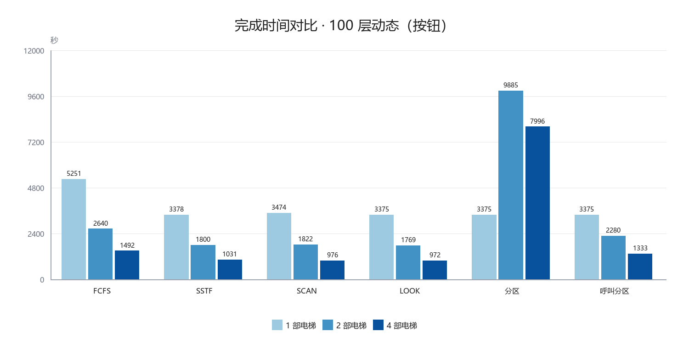
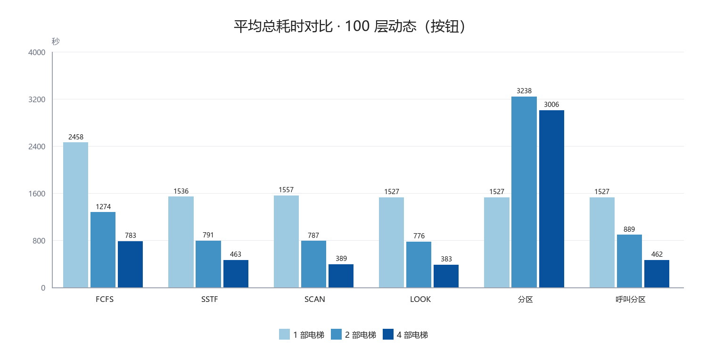
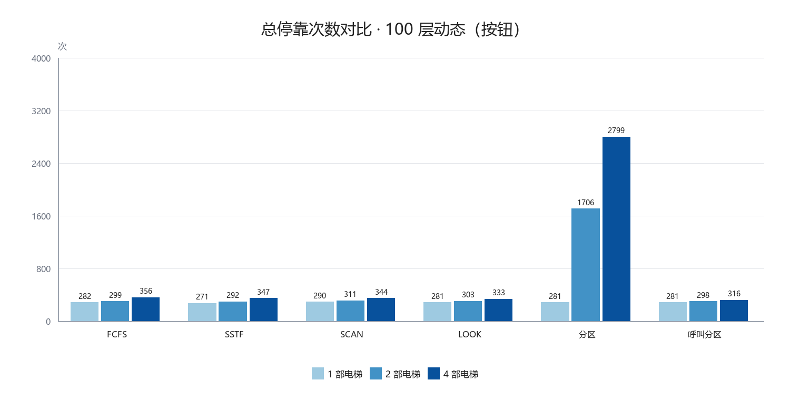

# 电梯调度算法对比报告 · 摩天楼动态混合（200 人陆续到达） · 只有上/下按钮

> 自动生成于 2026-11-21 16:52:10。**200 人分散在 0~360 s 内陆续出现（每秒开始时刷新，含两端），起点/终点全楼随机**，每部电梯容量 8 人，电梯初始都在 1 楼。

**需求表达方式**：电梯外只有上/下两个按钮，系统只知道有人要上楼或下楼、不知道去哪；需要目的层的派梯/分组算法无法使用。

**时间模型**：跨越 1 层 4s，2 层 6s，n≥2 层 4+n s；开关门各 2s；上下客每人 1s（最少 2s）。电梯只停靠有人的楼层。

每个组合跑 5 个随机种子（1, 2, 3, 4, 5），表中为均值。

本场景不参与对比：原程序（每层必停）、目的层派梯（ETA 均分）、目的层分组。

## 一、完成时间

把最后一位乘客送到目的层所用的秒数。这是最直观的“电梯够不够用”的指标。

| 算法 | 1 部电梯 | 2 部电梯 | 4 部电梯 |
| :--- | ---: | ---: | ---: |
| FCFS（先来先服务） | 5251 | 2640 | 1492 |
| SSTF（最近优先） | 3378 | 1800 | 1031 |
| SCAN（扫描） | 3474 | 1822 | 976 |
| LOOK（顺向截梯） | 3375 | 1769 | 972 |
| 目的层分区 | 3375 | 9885 | 7996 |
| 呼叫分区（按楼层） | 3375 | 2280 | 1333 |

## 二、平均总耗时（门到门）

每位乘客从“开始等待”到“走出电梯”的平均秒数。

| 算法 | 1 部电梯 | 2 部电梯 | 4 部电梯 |
| :--- | ---: | ---: | ---: |
| FCFS（先来先服务） | 2458 | 1274 | 783 |
| SSTF（最近优先） | 1536 | 791 | 463 |
| SCAN（扫描） | 1557 | 787 | 389 |
| LOOK（顺向截梯） | 1527 | 776 | 383 |
| 目的层分区 | 1527 | 3238 | 3006 |
| 呼叫分区（按楼层） | 1527 | 889 | 462 |

## 三、各电梯数量下的完整指标

### 1 部电梯

| 算法 | 完成时间 | 平均候梯 | 平均乘梯 | 平均总时 | P90 总时 | 停靠次数 | 运行层数 |
| :--- | ---: | ---: | ---: | ---: | ---: | ---: | ---: |
| FCFS（先来先服务） | 5251 | 2249 | 209 | 2458 | 4669 | 282 | 9383 |
| SSTF（最近优先） | 3378 | 1414 | 122 | 1536 | 2874 | 271 | 1886 |
| SCAN（扫描） | 3474 | 1468 | 88 | 1557 | 2974 | 290 | 1560 |
| LOOK（顺向截梯） | **3375** | 1439 | 88 | 1527 | 2906 | 281 | 1467 |
| 目的层分区 | 3375 | 1439 | 88 | 1527 | 2906 | 281 | 1467 |
| 呼叫分区（按楼层） | 3375 | 1439 | 88 | 1527 | 2906 | 281 | 1467 |

最快：**LOOK（顺向截梯）**，3375s。

### 2 部电梯

| 算法 | 完成时间 | 平均候梯 | 平均乘梯 | 平均总时 | P90 总时 | 停靠次数 | 运行层数 |
| :--- | ---: | ---: | ---: | ---: | ---: | ---: | ---: |
| FCFS（先来先服务） | 2640 | 1062 | 212 | 1274 | 2432 | 299 | 9955 |
| SSTF（最近优先） | 1800 | 666 | 125 | 791 | 1468 | 292 | 2141 |
| SCAN（扫描） | 1822 | 697 | 90 | 787 | 1496 | 311 | 1646 |
| LOOK（顺向截梯） | **1769** | 686 | 90 | 776 | 1465 | 303 | 1511 |
| 目的层分区 | 9885 | 3168 | 70 | 3238 | 8909 | 1706 | 8981 |
| 呼叫分区（按楼层） | 2280 | 826 | 63 | 889 | 1809 | 298 | 4877 |

最快：**LOOK（顺向截梯）**，1769s。

### 4 部电梯

| 算法 | 完成时间 | 平均候梯 | 平均乘梯 | 平均总时 | P90 总时 | 停靠次数 | 运行层数 |
| :--- | ---: | ---: | ---: | ---: | ---: | ---: | ---: |
| FCFS（先来先服务） | 1492 | 556 | 228 | 783 | 1418 | 356 | 11979 |
| SSTF（最近优先） | 1031 | 336 | 127 | 463 | 818 | 347 | 2361 |
| SCAN（扫描） | 976 | 299 | 90 | 389 | 729 | 344 | 2357 |
| LOOK（顺向截梯） | **972** | 294 | 90 | 383 | 707 | 333 | 1896 |
| 目的层分区 | 7996 | 2938 | 68 | 3006 | 7176 | 2799 | 12130 |
| 呼叫分区（按楼层） | 1333 | 404 | 58 | 462 | 943 | 316 | 5734 |

最快：**LOOK（顺向截梯）**，972s。

## 四、停靠次数与运行层数（省电与否）

停靠一次就要开关门 + 上下客，运行层数直接对应耗电。两者都是越小越省。

| 算法 | 1 部·停靠 | 2 部·停靠 | 4 部·停靠 | 1 部·层数 | 2 部·层数 | 4 部·层数 |
| :--- | ---: | ---: | ---: | ---: | ---: | ---: |
| FCFS（先来先服务） | 282 | 299 | 356 | 9383 | 9955 | 11979 |
| SSTF（最近优先） | 271 | 292 | 347 | 1886 | 2141 | 2361 |
| SCAN（扫描） | 290 | 311 | 344 | 1560 | 1646 | 2357 |
| LOOK（顺向截梯） | 281 | 303 | 333 | 1467 | 1511 | 1896 |
| 目的层分区 | 281 | 1706 | 2799 | 1467 | 8981 | 12130 |
| 呼叫分区（按楼层） | 281 | 298 | 316 | 1467 | 4877 | 5734 |

## 五、结论

- **1 部电梯**：最快 LOOK（顺向截梯） 3375s，其次 目的层分区 3375s（慢 0%）。
- **2 部电梯**：最快 LOOK（顺向截梯） 1769s，其次 SSTF（最近优先） 1800s（慢 2%）。
- **4 部电梯**：最快 LOOK（顺向截梯） 972s，其次 SCAN（扫描） 976s（慢 0%）。

完整分析见 README.md。
