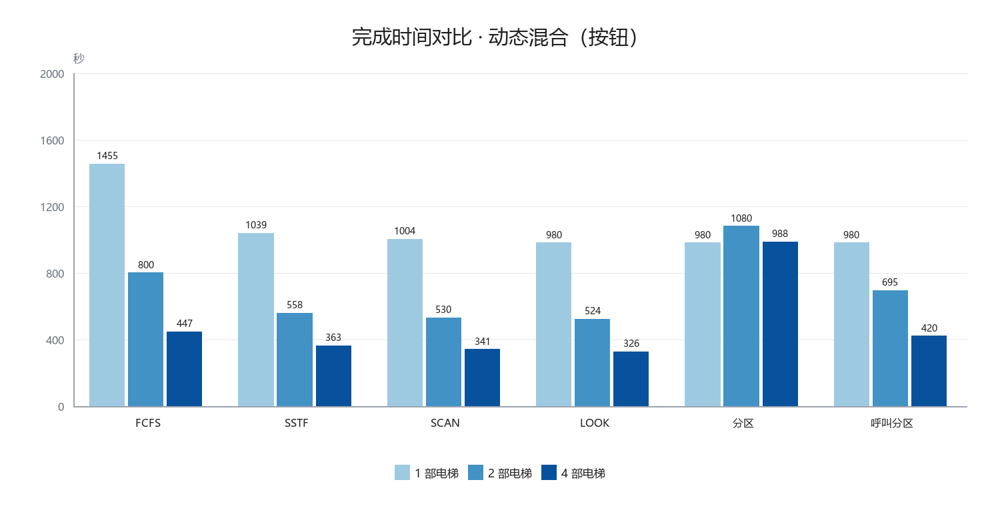
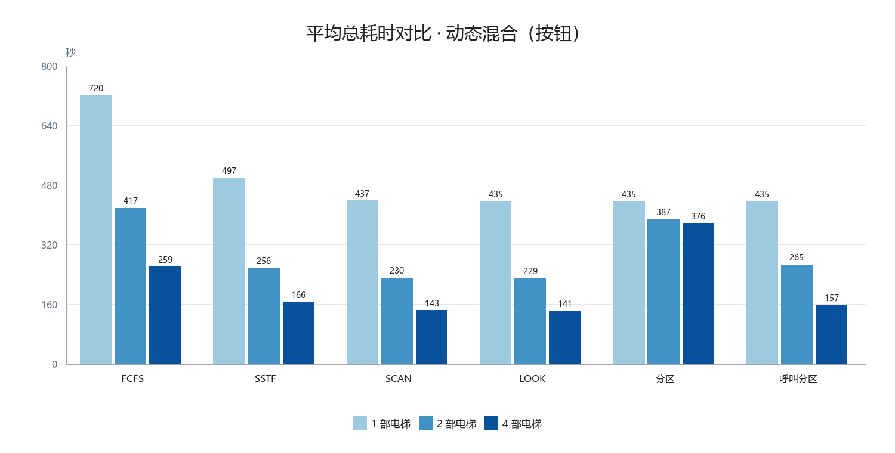
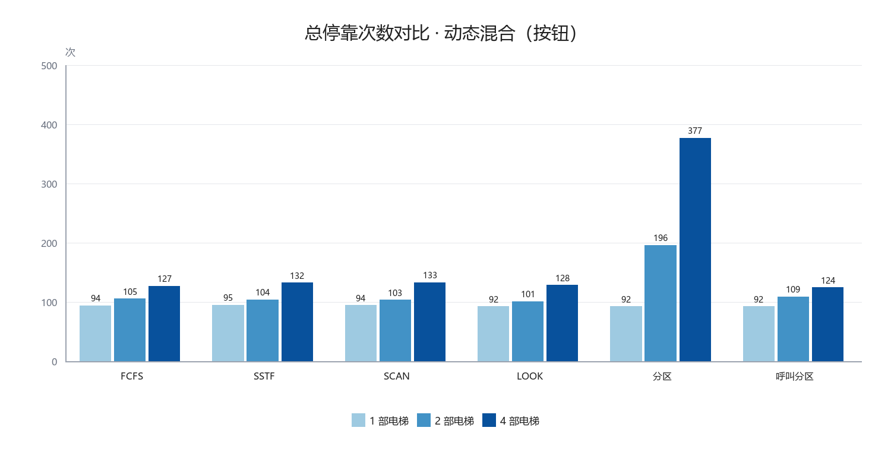

# 电梯调度算法对比报告 · 动态混合（乘客陆续到达） · 只有上/下按钮

> 自动生成于 2026-11-21 16:51:50。**100 人分散在 0~180 s 内陆续出现（每秒开始时刷新，含两端），起点/终点全楼随机**，每部电梯容量 8 人，电梯初始都在 1 楼。

**需求表达方式**：电梯外只有上/下两个按钮，系统只知道有人要上楼或下楼、不知道去哪；需要目的层的派梯/分组算法无法使用。

**时间模型**：跨越 1 层 4s，2 层 6s，n≥2 层 4+n s；开关门各 2s；上下客每人 1s（最少 2s）。电梯只停靠有人的楼层。

每个组合跑 5 个随机种子（1, 2, 3, 4, 5），表中为均值。

本场景不参与对比：原程序（每层必停）、目的层派梯（ETA 均分）、目的层分组。

## 一、完成时间

把最后一位乘客送到目的层所用的秒数。这是最直观的“电梯够不够用”的指标。

| 算法 | 1 部电梯 | 2 部电梯 | 4 部电梯 |
| :--- | ---: | ---: | ---: |
| FCFS（先来先服务） | 1455 | 800 | 447 |
| SSTF（最近优先） | 1039 | 558 | 363 |
| SCAN（扫描） | 1004 | 530 | 341 |
| LOOK（顺向截梯） | 980 | 524 | 326 |
| 目的层分区 | 980 | 1080 | 988 |
| 呼叫分区（按楼层） | 980 | 695 | 420 |

## 二、平均总耗时（门到门）

每位乘客从“开始等待”到“走出电梯”的平均秒数。

| 算法 | 1 部电梯 | 2 部电梯 | 4 部电梯 |
| :--- | ---: | ---: | ---: |
| FCFS（先来先服务） | 720 | 417 | 259 |
| SSTF（最近优先） | 497 | 256 | 166 |
| SCAN（扫描） | 437 | 230 | 143 |
| LOOK（顺向截梯） | 435 | 229 | 141 |
| 目的层分区 | 435 | 387 | 376 |
| 呼叫分区（按楼层） | 435 | 265 | 157 |

## 三、各电梯数量下的完整指标

### 1 部电梯

| 算法 | 完成时间 | 平均候梯 | 平均乘梯 | 平均总时 | P90 总时 | 停靠次数 | 运行层数 |
| :--- | ---: | ---: | ---: | ---: | ---: | ---: | ---: |
| FCFS（先来先服务） | 1455 | 605 | 116 | 720 | 1313 | 94 | 663 |
| SSTF（最近优先） | 1039 | 421 | 77 | 497 | 904 | 95 | 226 |
| SCAN（扫描） | 1004 | 385 | 53 | 437 | 833 | 94 | 179 |
| LOOK（顺向截梯） | **980** | 382 | 53 | 435 | 826 | 92 | 168 |
| 目的层分区 | 980 | 382 | 53 | 435 | 826 | 92 | 168 |
| 呼叫分区（按楼层） | 980 | 382 | 53 | 435 | 826 | 92 | 168 |

最快：**LOOK（顺向截梯）**，980s。

### 2 部电梯

| 算法 | 完成时间 | 平均候梯 | 平均乘梯 | 平均总时 | P90 总时 | 停靠次数 | 运行层数 |
| :--- | ---: | ---: | ---: | ---: | ---: | ---: | ---: |
| FCFS（先来先服务） | 800 | 294 | 123 | 417 | 735 | 105 | 792 |
| SSTF（最近优先） | 558 | 180 | 76 | 256 | 447 | 104 | 248 |
| SCAN（扫描） | 530 | 179 | 52 | 230 | 412 | 103 | 226 |
| LOOK（顺向截梯） | **524** | 178 | 51 | 229 | 405 | 101 | 199 |
| 目的层分区 | 1080 | 344 | 43 | 387 | 881 | 196 | 465 |
| 呼叫分区（按楼层） | 695 | 221 | 44 | 265 | 514 | 109 | 357 |

最快：**LOOK（顺向截梯）**，524s。

### 4 部电梯

| 算法 | 完成时间 | 平均候梯 | 平均乘梯 | 平均总时 | P90 总时 | 停靠次数 | 运行层数 |
| :--- | ---: | ---: | ---: | ---: | ---: | ---: | ---: |
| FCFS（先来先服务） | 447 | 144 | 115 | 259 | 402 | 127 | 929 |
| SSTF（最近优先） | 363 | 91 | 74 | 166 | 267 | 132 | 303 |
| SCAN（扫描） | 341 | 90 | 53 | 143 | 243 | 133 | 327 |
| LOOK（顺向截梯） | **326** | 89 | 52 | 141 | 236 | 128 | 270 |
| 目的层分区 | 988 | 338 | 39 | 376 | 816 | 377 | 793 |
| 呼叫分区（按楼层） | 420 | 117 | 40 | 157 | 291 | 124 | 480 |

最快：**LOOK（顺向截梯）**，326s。

## 四、停靠次数与运行层数（省电与否）

停靠一次就要开关门 + 上下客，运行层数直接对应耗电。两者都是越小越省。

| 算法 | 1 部·停靠 | 2 部·停靠 | 4 部·停靠 | 1 部·层数 | 2 部·层数 | 4 部·层数 |
| :--- | ---: | ---: | ---: | ---: | ---: | ---: |
| FCFS（先来先服务） | 94 | 105 | 127 | 663 | 792 | 929 |
| SSTF（最近优先） | 95 | 104 | 132 | 226 | 248 | 303 |
| SCAN（扫描） | 94 | 103 | 133 | 179 | 226 | 327 |
| LOOK（顺向截梯） | 92 | 101 | 128 | 168 | 199 | 270 |
| 目的层分区 | 92 | 196 | 377 | 168 | 465 | 793 |
| 呼叫分区（按楼层） | 92 | 109 | 124 | 168 | 357 | 480 |

## 五、结论

- **1 部电梯**：最快 LOOK（顺向截梯） 980s，其次 目的层分区 980s（慢 0%）。
- **2 部电梯**：最快 LOOK（顺向截梯） 524s，其次 SCAN（扫描） 530s（慢 1%）。
- **4 部电梯**：最快 LOOK（顺向截梯） 326s，其次 SCAN（扫描） 341s（慢 5%）。

完整分析见 README.md。
