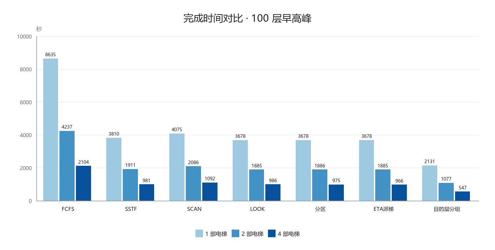
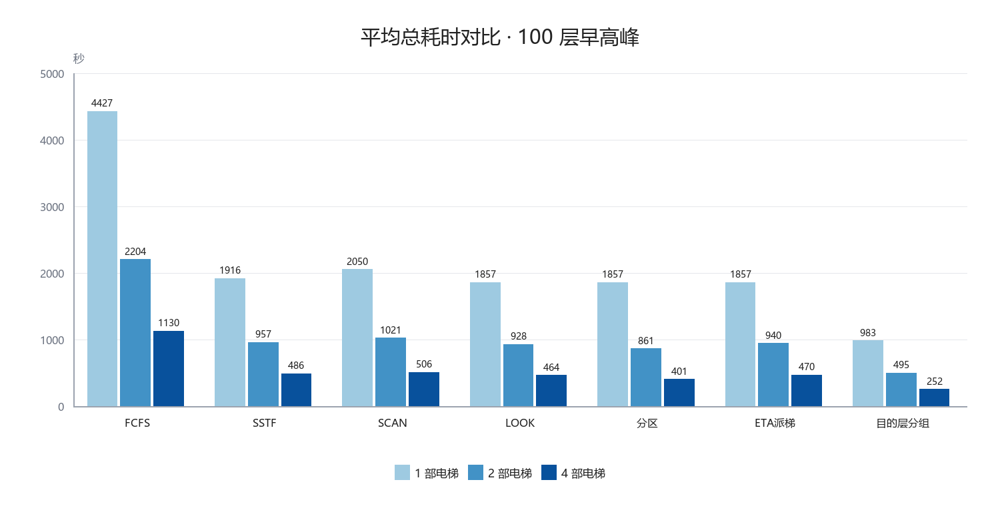
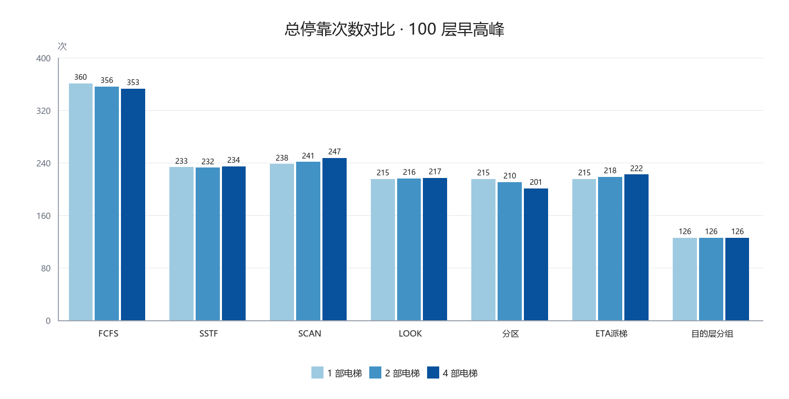

# 电梯调度算法对比报告 · 摩天楼早高峰（200 人全在 1 楼） · 目的地已知（每层 20 个按钮 / 触摸屏）

> 自动生成于 2026-11-21 16:51:53。**200 人全部在 1 楼等候，目的地 2~100 层随机（100 层楼、4 倍速）**，每部电梯容量 8 人，电梯初始都在 1 楼。

**需求表达方式**：乘客在进电梯前就选好目的层，系统知道每个人的去向。

**时间模型**：跨越 1 层 4s，2 层 6s，n≥2 层 4+n s；开关门各 2s；上下客每人 1s（最少 2s）。电梯只停靠有人的楼层。

每个组合跑 5 个随机种子（1, 2, 3, 4, 5），表中为均值。

本场景不参与对比：原程序（每层必停）、呼叫分区（按楼层）。

## 一、完成时间

把最后一位乘客送到目的层所用的秒数。这是最直观的“电梯够不够用”的指标。

| 算法 | 1 部电梯 | 2 部电梯 | 4 部电梯 |
| :--- | ---: | ---: | ---: |
| FCFS（先来先服务） | 8635 | 4237 | 2104 |
| SSTF（最近优先） | 3810 | 1911 | 981 |
| SCAN（扫描） | 4075 | 2086 | 1092 |
| LOOK（顺向截梯） | 3678 | 1885 | 986 |
| 目的层分区 | 3678 | 1886 | 975 |
| 目的层派梯（ETA 均分） | 3678 | 1885 | 966 |
| 目的层分组 | 2131 | 1077 | 547 |

## 二、平均总耗时（门到门）

每位乘客从“开始等待”到“走出电梯”的平均秒数。

| 算法 | 1 部电梯 | 2 部电梯 | 4 部电梯 |
| :--- | ---: | ---: | ---: |
| FCFS（先来先服务） | 4427 | 2204 | 1130 |
| SSTF（最近优先） | 1916 | 957 | 486 |
| SCAN（扫描） | 2050 | 1021 | 506 |
| LOOK（顺向截梯） | 1857 | 928 | 464 |
| 目的层分区 | 1857 | 861 | 401 |
| 目的层派梯（ETA 均分） | 1857 | 940 | 470 |
| 目的层分组 | 983 | 495 | 252 |

## 三、各电梯数量下的完整指标

### 1 部电梯

| 算法 | 完成时间 | 平均候梯 | 平均乘梯 | 平均总时 | P90 总时 | 停靠次数 | 运行层数 |
| :--- | ---: | ---: | ---: | ---: | ---: | ---: | ---: |
| FCFS（先来先服务） | 8635 | 4107 | 319 | 4427 | 7929 | 360 | 17817 |
| SSTF（最近优先） | 3810 | 1838 | 78 | 1916 | 3453 | 233 | 4055 |
| SCAN（扫描） | 4075 | 1989 | 62 | 2050 | 3692 | 238 | 4830 |
| LOOK（顺向截梯） | 3678 | 1795 | 62 | 1857 | 3332 | 215 | 4260 |
| 目的层分区 | 3678 | 1795 | 62 | 1857 | 3332 | 215 | 4260 |
| 目的层派梯（ETA 均分） | 3678 | 1795 | 62 | 1857 | 3332 | 215 | 4260 |
| 目的层分组 | **2131** | 942 | 40 | 983 | 1899 | 126 | 2458 |

最快：**目的层分组**，2131s。

### 2 部电梯

| 算法 | 完成时间 | 平均候梯 | 平均乘梯 | 平均总时 | P90 总时 | 停靠次数 | 运行层数 |
| :--- | ---: | ---: | ---: | ---: | ---: | ---: | ---: |
| FCFS（先来先服务） | 4237 | 1894 | 310 | 2204 | 3977 | 356 | 17366 |
| SSTF（最近优先） | 1911 | 879 | 78 | 957 | 1727 | 232 | 4005 |
| SCAN（扫描） | 2086 | 959 | 62 | 1021 | 1856 | 241 | 5127 |
| LOOK（顺向截梯） | 1885 | 866 | 62 | 928 | 1677 | 216 | 4229 |
| 目的层分区 | 1886 | 801 | 60 | 861 | 1587 | 210 | 3366 |
| 目的层派梯（ETA 均分） | 1885 | 879 | 61 | 940 | 1698 | 218 | 4400 |
| 目的层分组 | **1077** | 455 | 40 | 495 | 947 | 126 | 2364 |

最快：**目的层分组**，1077s。

### 4 部电梯

| 算法 | 完成时间 | 平均候梯 | 平均乘梯 | 平均总时 | P90 总时 | 停靠次数 | 运行层数 |
| :--- | ---: | ---: | ---: | ---: | ---: | ---: | ---: |
| FCFS（先来先服务） | 2104 | 829 | 301 | 1130 | 1992 | 353 | 17009 |
| SSTF（最近优先） | 981 | 408 | 78 | 486 | 871 | 234 | 3837 |
| SCAN（扫描） | 1092 | 445 | 62 | 506 | 910 | 247 | 5721 |
| LOOK（顺向截梯） | 986 | 402 | 62 | 464 | 829 | 217 | 4145 |
| 目的层分区 | 975 | 345 | 56 | 401 | 737 | 201 | 2938 |
| 目的层派梯（ETA 均分） | 966 | 409 | 61 | 470 | 839 | 222 | 4490 |
| 目的层分组 | **547** | 211 | 40 | 252 | 483 | 126 | 2188 |

最快：**目的层分组**，547s。

## 四、停靠次数与运行层数（省电与否）

停靠一次就要开关门 + 上下客，运行层数直接对应耗电。两者都是越小越省。

| 算法 | 1 部·停靠 | 2 部·停靠 | 4 部·停靠 | 1 部·层数 | 2 部·层数 | 4 部·层数 |
| :--- | ---: | ---: | ---: | ---: | ---: | ---: |
| FCFS（先来先服务） | 360 | 356 | 353 | 17817 | 17366 | 17009 |
| SSTF（最近优先） | 233 | 232 | 234 | 4055 | 4005 | 3837 |
| SCAN（扫描） | 238 | 241 | 247 | 4830 | 5127 | 5721 |
| LOOK（顺向截梯） | 215 | 216 | 217 | 4260 | 4229 | 4145 |
| 目的层分区 | 215 | 210 | 201 | 4260 | 3366 | 2938 |
| 目的层派梯（ETA 均分） | 215 | 218 | 222 | 4260 | 4400 | 4490 |
| 目的层分组 | 126 | 126 | 126 | 2458 | 2364 | 2188 |

## 五、结论

- **1 部电梯**：最快 目的层分组 2131s，其次 LOOK（顺向截梯） 3678s（慢 73%）。
- **2 部电梯**：最快 目的层分组 1077s，其次 LOOK（顺向截梯） 1885s（慢 75%）。
- **4 部电梯**：最快 目的层分组 547s，其次 目的层派梯（ETA 均分） 966s（慢 77%）。

完整分析见 README.md。
