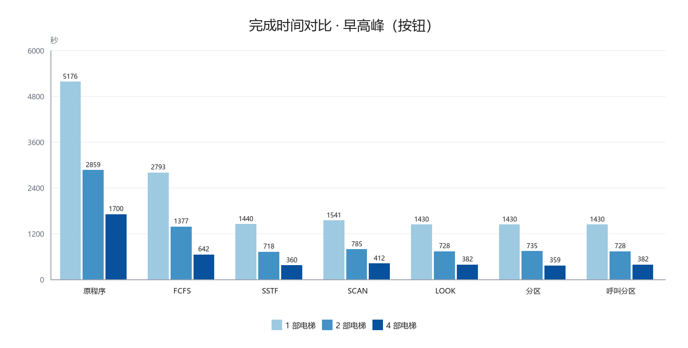
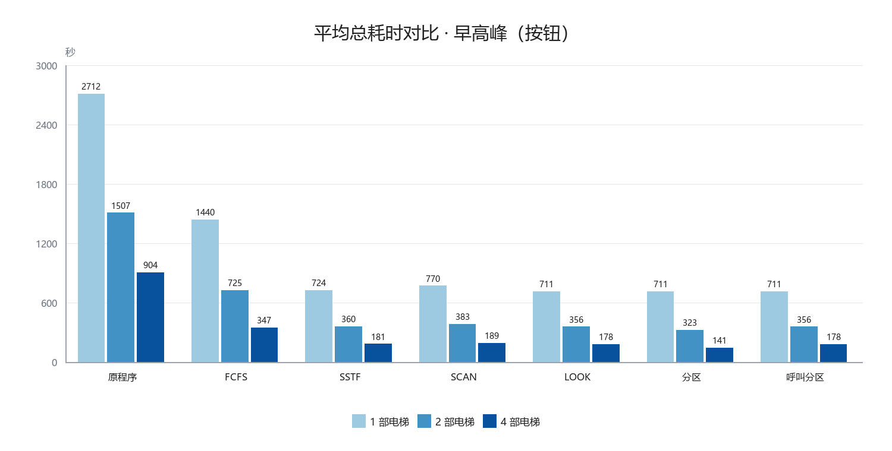
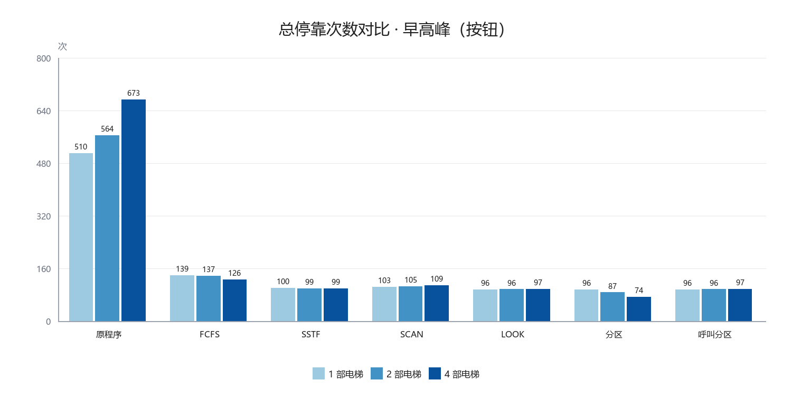

# 电梯调度算法对比报告 · 早高峰（100 人全在 1 楼） · 只有上/下按钮

> 自动生成于 2026-11-21 16:51:48。**100 人全部在 1 楼等候，目的地 2~20 层随机（20 层楼）**，每部电梯容量 8 人，电梯初始都在 1 楼。

**需求表达方式**：电梯外只有上/下两个按钮，系统只知道有人要上楼或下楼、不知道去哪；需要目的层的派梯/分组算法无法使用。

**时间模型**：跨越 1 层 4s，2 层 6s，n≥2 层 4+n s；开关门各 2s；上下客每人 1s（最少 2s）。电梯只停靠有人的楼层。

每个组合跑 5 个随机种子（1, 2, 3, 4, 5），表中为均值。

本场景不参与对比：目的层派梯（ETA 均分）、目的层分组。

## 一、完成时间

把最后一位乘客送到目的层所用的秒数。这是最直观的“电梯够不够用”的指标。

| 算法 | 1 部电梯 | 2 部电梯 | 4 部电梯 |
| :--- | ---: | ---: | ---: |
| 原程序（每层必停） | 5176 | 2859 | 1700 |
| FCFS（先来先服务） | 2793 | 1377 | 642 |
| SSTF（最近优先） | 1440 | 718 | 360 |
| SCAN（扫描） | 1541 | 785 | 412 |
| LOOK（顺向截梯） | 1430 | 728 | 382 |
| 目的层分区 | 1430 | 735 | 359 |
| 呼叫分区（按楼层） | 1430 | 728 | 382 |

## 二、平均总耗时（门到门）

每位乘客从“开始等待”到“走出电梯”的平均秒数。

| 算法 | 1 部电梯 | 2 部电梯 | 4 部电梯 |
| :--- | ---: | ---: | ---: |
| 原程序（每层必停） | 2712 | 1507 | 904 |
| FCFS（先来先服务） | 1440 | 725 | 347 |
| SSTF（最近优先） | 724 | 360 | 181 |
| SCAN（扫描） | 770 | 383 | 189 |
| LOOK（顺向截梯） | 711 | 356 | 178 |
| 目的层分区 | 711 | 323 | 141 |
| 呼叫分区（按楼层） | 711 | 356 | 178 |

## 三、各电梯数量下的完整指标

### 1 部电梯

| 算法 | 完成时间 | 平均候梯 | 平均乘梯 | 平均总时 | P90 总时 | 停靠次数 | 运行层数 |
| :--- | ---: | ---: | ---: | ---: | ---: | ---: | ---: |
| 原程序（每层必停） | 5176 | 2608 | 104 | 2712 | 4678 | 510 | 510 |
| FCFS（先来先服务） | 2793 | 1240 | 200 | 1440 | 2599 | 139 | 1399 |
| SSTF（最近优先） | 1440 | 669 | 55 | 724 | 1290 | 100 | 409 |
| SCAN（扫描） | 1541 | 724 | 46 | 770 | 1389 | 103 | 472 |
| LOOK（顺向截梯） | **1430** | 665 | 46 | 711 | 1283 | 96 | 433 |
| 目的层分区 | 1430 | 665 | 46 | 711 | 1283 | 96 | 433 |
| 呼叫分区（按楼层） | 1430 | 665 | 46 | 711 | 1283 | 96 | 433 |

最快：**LOOK（顺向截梯）**，1430s。

### 2 部电梯

| 算法 | 完成时间 | 平均候梯 | 平均乘梯 | 平均总时 | P90 总时 | 停靠次数 | 运行层数 |
| :--- | ---: | ---: | ---: | ---: | ---: | ---: | ---: |
| 原程序（每层必停） | 2859 | 1403 | 104 | 1507 | 2427 | 564 | 564 |
| FCFS（先来先服务） | 1377 | 535 | 191 | 725 | 1289 | 137 | 1358 |
| SSTF（最近优先） | **718** | 306 | 54 | 360 | 641 | 99 | 390 |
| SCAN（扫描） | 785 | 337 | 46 | 383 | 681 | 105 | 499 |
| LOOK（顺向截梯） | 728 | 310 | 46 | 356 | 631 | 96 | 422 |
| 目的层分区 | 735 | 281 | 42 | 323 | 621 | 87 | 346 |
| 呼叫分区（按楼层） | 728 | 310 | 46 | 356 | 631 | 96 | 422 |

最快：**SSTF（最近优先）**，718s。

### 4 部电梯

| 算法 | 完成时间 | 平均候梯 | 平均乘梯 | 平均总时 | P90 总时 | 停靠次数 | 运行层数 |
| :--- | ---: | ---: | ---: | ---: | ---: | ---: | ---: |
| 原程序（每层必停） | 1700 | 801 | 104 | 904 | 1315 | 673 | 673 |
| FCFS（先来先服务） | 642 | 185 | 163 | 347 | 579 | 126 | 1214 |
| SSTF（最近优先） | 360 | 128 | 53 | 181 | 318 | 99 | 353 |
| SCAN（扫描） | 412 | 143 | 46 | 189 | 330 | 109 | 552 |
| LOOK（顺向截梯） | 382 | 131 | 46 | 178 | 310 | 97 | 407 |
| 目的层分区 | **359** | 106 | 35 | 141 | 274 | 74 | 313 |
| 呼叫分区（按楼层） | 382 | 131 | 46 | 178 | 310 | 97 | 407 |

最快：**目的层分区**，359s。

## 四、停靠次数与运行层数（省电与否）

停靠一次就要开关门 + 上下客，运行层数直接对应耗电。两者都是越小越省。

| 算法 | 1 部·停靠 | 2 部·停靠 | 4 部·停靠 | 1 部·层数 | 2 部·层数 | 4 部·层数 |
| :--- | ---: | ---: | ---: | ---: | ---: | ---: |
| 原程序（每层必停） | 510 | 564 | 673 | 510 | 564 | 673 |
| FCFS（先来先服务） | 139 | 137 | 126 | 1399 | 1358 | 1214 |
| SSTF（最近优先） | 100 | 99 | 99 | 409 | 390 | 353 |
| SCAN（扫描） | 103 | 105 | 109 | 472 | 499 | 552 |
| LOOK（顺向截梯） | 96 | 96 | 97 | 433 | 422 | 407 |
| 目的层分区 | 96 | 87 | 74 | 433 | 346 | 313 |
| 呼叫分区（按楼层） | 96 | 96 | 97 | 433 | 422 | 407 |

## 五、结论

- **1 部电梯**：最快 LOOK（顺向截梯） 1430s，其次 目的层分区 1430s（慢 0%）；原程序 5176s，光是跳层 + 正确换向就快 3.6 倍。
- **2 部电梯**：最快 SSTF（最近优先） 718s，其次 LOOK（顺向截梯） 728s（慢 1%）；原程序 2859s，光是跳层 + 正确换向就快 3.9 倍。
- **4 部电梯**：最快 目的层分区 359s，其次 SSTF（最近优先） 360s（慢 0%）；原程序 1700s，光是跳层 + 正确换向就快 4.7 倍。

完整分析见 README.md。
