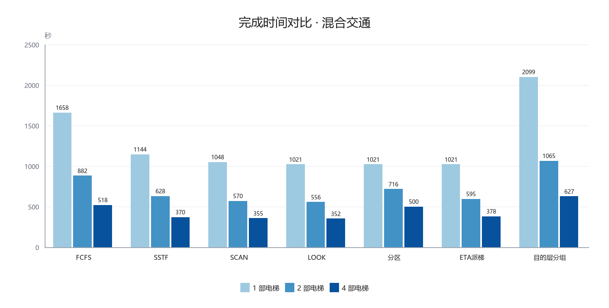
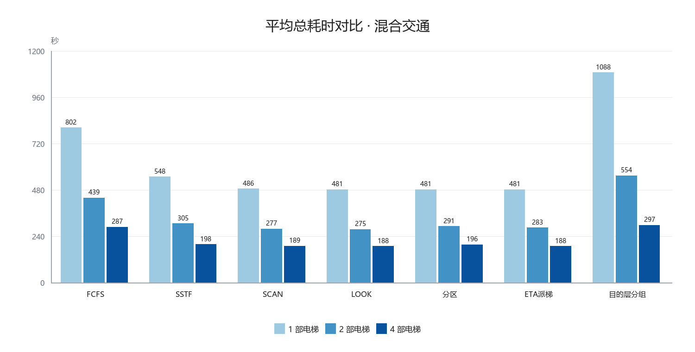
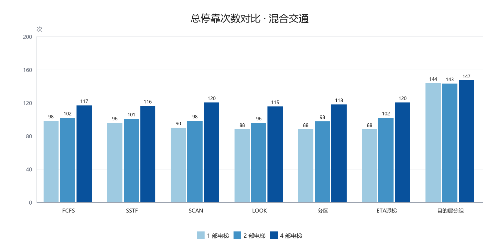

# 电梯调度算法对比报告 · 混合交通（起点终点全楼随机） · 目的地已知（每层 20 个按钮 / 触摸屏）

> 自动生成于 2026-11-21 16:51:48。**100 人随机分布在 1~20 层，目的地是除本层外的随机楼层，全部在 t=0 就已在候梯**，每部电梯容量 8 人，电梯初始都在 1 楼。

**需求表达方式**：乘客在进电梯前就选好目的层，系统知道每个人的去向。

**时间模型**：跨越 1 层 4s，2 层 6s，n≥2 层 4+n s；开关门各 2s；上下客每人 1s（最少 2s）。电梯只停靠有人的楼层。

每个组合跑 5 个随机种子（1, 2, 3, 4, 5），表中为均值。

本场景不参与对比：原程序（每层必停）、呼叫分区（按楼层）。

## 一、完成时间

把最后一位乘客送到目的层所用的秒数。这是最直观的“电梯够不够用”的指标。

| 算法 | 1 部电梯 | 2 部电梯 | 4 部电梯 |
| :--- | ---: | ---: | ---: |
| FCFS（先来先服务） | 1658 | 882 | 518 |
| SSTF（最近优先） | 1144 | 628 | 370 |
| SCAN（扫描） | 1048 | 570 | 355 |
| LOOK（顺向截梯） | 1021 | 556 | 352 |
| 目的层分区 | 1021 | 716 | 500 |
| 目的层派梯（ETA 均分） | 1021 | 595 | 378 |
| 目的层分组 | 2099 | 1065 | 627 |

## 二、平均总耗时（门到门）

每位乘客从“开始等待”到“走出电梯”的平均秒数。

| 算法 | 1 部电梯 | 2 部电梯 | 4 部电梯 |
| :--- | ---: | ---: | ---: |
| FCFS（先来先服务） | 802 | 439 | 287 |
| SSTF（最近优先） | 548 | 305 | 198 |
| SCAN（扫描） | 486 | 277 | 189 |
| LOOK（顺向截梯） | 481 | 275 | 188 |
| 目的层分区 | 481 | 291 | 196 |
| 目的层派梯（ETA 均分） | 481 | 283 | 188 |
| 目的层分组 | 1088 | 554 | 297 |

## 三、各电梯数量下的完整指标

### 1 部电梯

| 算法 | 完成时间 | 平均候梯 | 平均乘梯 | 平均总时 | P90 总时 | 停靠次数 | 运行层数 |
| :--- | ---: | ---: | ---: | ---: | ---: | ---: | ---: |
| FCFS（先来先服务） | 1658 | 681 | 121 | 802 | 1493 | 98 | 661 |
| SSTF（最近优先） | 1144 | 471 | 76 | 548 | 1008 | 96 | 200 |
| SCAN（扫描） | 1048 | 435 | 50 | 486 | 907 | 90 | 158 |
| LOOK（顺向截梯） | **1021** | 431 | 50 | 481 | 890 | 88 | 151 |
| 目的层分区 | 1021 | 431 | 50 | 481 | 890 | 88 | 151 |
| 目的层派梯（ETA 均分） | 1021 | 431 | 50 | 481 | 890 | 88 | 151 |
| 目的层分组 | 2099 | 1056 | 31 | 1088 | 1867 | 144 | 700 |

最快：**LOOK（顺向截梯）**，1021s。

### 2 部电梯

| 算法 | 完成时间 | 平均候梯 | 平均乘梯 | 平均总时 | P90 总时 | 停靠次数 | 运行层数 |
| :--- | ---: | ---: | ---: | ---: | ---: | ---: | ---: |
| FCFS（先来先服务） | 882 | 319 | 120 | 439 | 801 | 102 | 706 |
| SSTF（最近优先） | 628 | 229 | 76 | 305 | 533 | 101 | 223 |
| SCAN（扫描） | 570 | 224 | 53 | 277 | 499 | 98 | 179 |
| LOOK（顺向截梯） | **556** | 222 | 53 | 275 | 488 | 96 | 154 |
| 目的层分区 | 716 | 254 | 37 | 291 | 566 | 98 | 356 |
| 目的层派梯（ETA 均分） | 595 | 233 | 51 | 283 | 503 | 102 | 189 |
| 目的层分组 | 1065 | 522 | 32 | 554 | 946 | 143 | 688 |

最快：**LOOK（顺向截梯）**，556s。

### 4 部电梯

| 算法 | 完成时间 | 平均候梯 | 平均乘梯 | 平均总时 | P90 总时 | 停靠次数 | 运行层数 |
| :--- | ---: | ---: | ---: | ---: | ---: | ---: | ---: |
| FCFS（先来先服务） | 518 | 171 | 116 | 287 | 460 | 117 | 778 |
| SSTF（最近优先） | 370 | 125 | 73 | 198 | 321 | 116 | 256 |
| SCAN（扫描） | 355 | 134 | 56 | 189 | 293 | 120 | 276 |
| LOOK（顺向截梯） | **352** | 134 | 54 | 188 | 292 | 115 | 224 |
| 目的层分区 | 500 | 165 | 32 | 196 | 381 | 118 | 496 |
| 目的层派梯（ETA 均分） | 378 | 136 | 52 | 188 | 301 | 120 | 232 |
| 目的层分组 | 627 | 268 | 30 | 297 | 486 | 147 | 775 |

最快：**LOOK（顺向截梯）**，352s。

## 四、停靠次数与运行层数（省电与否）

停靠一次就要开关门 + 上下客，运行层数直接对应耗电。两者都是越小越省。

| 算法 | 1 部·停靠 | 2 部·停靠 | 4 部·停靠 | 1 部·层数 | 2 部·层数 | 4 部·层数 |
| :--- | ---: | ---: | ---: | ---: | ---: | ---: |
| FCFS（先来先服务） | 98 | 102 | 117 | 661 | 706 | 778 |
| SSTF（最近优先） | 96 | 101 | 116 | 200 | 223 | 256 |
| SCAN（扫描） | 90 | 98 | 120 | 158 | 179 | 276 |
| LOOK（顺向截梯） | 88 | 96 | 115 | 151 | 154 | 224 |
| 目的层分区 | 88 | 98 | 118 | 151 | 356 | 496 |
| 目的层派梯（ETA 均分） | 88 | 102 | 120 | 151 | 189 | 232 |
| 目的层分组 | 144 | 143 | 147 | 700 | 688 | 775 |

## 五、结论

- **1 部电梯**：最快 LOOK（顺向截梯） 1021s，其次 目的层分区 1021s（慢 0%）。
- **2 部电梯**：最快 LOOK（顺向截梯） 556s，其次 SCAN（扫描） 570s（慢 3%）。
- **4 部电梯**：最快 LOOK（顺向截梯） 352s，其次 SCAN（扫描） 355s（慢 1%）。

完整分析见 README.md。
