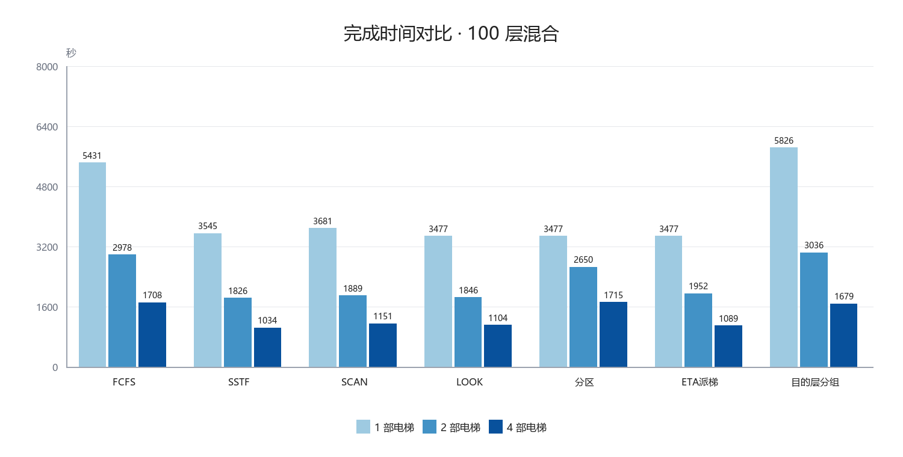
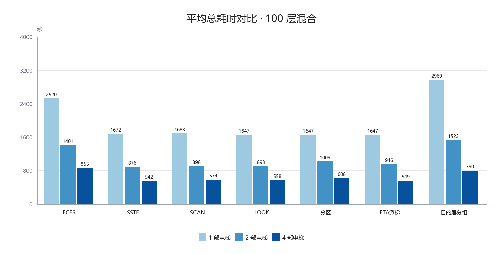
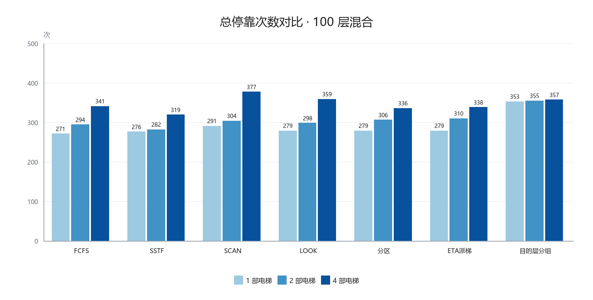

# 电梯调度算法对比报告 · 摩天楼混合交通（起点终点全楼随机） · 目的地已知（每层 20 个按钮 / 触摸屏）

> 自动生成于 2026-11-21 16:52:00。**200 人随机分布在 1~100 层，目的地是除本层外的随机楼层，全部同时候梯**，每部电梯容量 8 人，电梯初始都在 1 楼。

**需求表达方式**：乘客在进电梯前就选好目的层，系统知道每个人的去向。

**时间模型**：跨越 1 层 4s，2 层 6s，n≥2 层 4+n s；开关门各 2s；上下客每人 1s（最少 2s）。电梯只停靠有人的楼层。

每个组合跑 5 个随机种子（1, 2, 3, 4, 5），表中为均值。

本场景不参与对比：原程序（每层必停）、呼叫分区（按楼层）。

## 一、完成时间

把最后一位乘客送到目的层所用的秒数。这是最直观的“电梯够不够用”的指标。

| 算法 | 1 部电梯 | 2 部电梯 | 4 部电梯 |
| :--- | ---: | ---: | ---: |
| FCFS（先来先服务） | 5431 | 2978 | 1708 |
| SSTF（最近优先） | 3545 | 1826 | 1034 |
| SCAN（扫描） | 3681 | 1889 | 1151 |
| LOOK（顺向截梯） | 3477 | 1846 | 1104 |
| 目的层分区 | 3477 | 2650 | 1715 |
| 目的层派梯（ETA 均分） | 3477 | 1952 | 1089 |
| 目的层分组 | 5826 | 3036 | 1679 |

## 二、平均总耗时（门到门）

每位乘客从“开始等待”到“走出电梯”的平均秒数。

| 算法 | 1 部电梯 | 2 部电梯 | 4 部电梯 |
| :--- | ---: | ---: | ---: |
| FCFS（先来先服务） | 2520 | 1401 | 855 |
| SSTF（最近优先） | 1672 | 876 | 542 |
| SCAN（扫描） | 1683 | 898 | 574 |
| LOOK（顺向截梯） | 1647 | 893 | 558 |
| 目的层分区 | 1647 | 1009 | 608 |
| 目的层派梯（ETA 均分） | 1647 | 946 | 549 |
| 目的层分组 | 2969 | 1523 | 790 |

## 三、各电梯数量下的完整指标

### 1 部电梯

| 算法 | 完成时间 | 平均候梯 | 平均乘梯 | 平均总时 | P90 总时 | 停靠次数 | 运行层数 |
| :--- | ---: | ---: | ---: | ---: | ---: | ---: | ---: |
| FCFS（先来先服务） | 5431 | 2317 | 204 | 2520 | 4820 | 271 | 9137 |
| SSTF（最近优先） | 3545 | 1546 | 126 | 1672 | 3153 | 276 | 1918 |
| SCAN（扫描） | 3681 | 1595 | 87 | 1683 | 3129 | 291 | 1870 |
| LOOK（顺向截梯） | **3477** | 1560 | 87 | 1647 | 3040 | 279 | 1603 |
| 目的层分区 | 3477 | 1560 | 87 | 1647 | 3040 | 279 | 1603 |
| 目的层派梯（ETA 均分） | 3477 | 1560 | 87 | 1647 | 3040 | 279 | 1603 |
| 目的层分组 | 5826 | 2924 | 45 | 2969 | 5211 | 353 | 7284 |

最快：**LOOK（顺向截梯）**，3477s。

### 2 部电梯

| 算法 | 完成时间 | 平均候梯 | 平均乘梯 | 平均总时 | P90 总时 | 停靠次数 | 运行层数 |
| :--- | ---: | ---: | ---: | ---: | ---: | ---: | ---: |
| FCFS（先来先服务） | 2978 | 1184 | 216 | 1401 | 2704 | 294 | 10073 |
| SSTF（最近优先） | **1826** | 753 | 123 | 876 | 1619 | 282 | 1925 |
| SCAN（扫描） | 1889 | 808 | 89 | 898 | 1652 | 304 | 1790 |
| LOOK（顺向截梯） | 1846 | 804 | 90 | 893 | 1625 | 298 | 1539 |
| 目的层分区 | 2650 | 950 | 59 | 1009 | 2055 | 306 | 6109 |
| 目的层派梯（ETA 均分） | 1952 | 854 | 92 | 946 | 1684 | 310 | 1632 |
| 目的层分组 | 3036 | 1480 | 44 | 1523 | 2671 | 355 | 7587 |

最快：**SSTF（最近优先）**，1826s。

### 4 部电梯

| 算法 | 完成时间 | 平均候梯 | 平均乘梯 | 平均总时 | P90 总时 | 停靠次数 | 运行层数 |
| :--- | ---: | ---: | ---: | ---: | ---: | ---: | ---: |
| FCFS（先来先服务） | 1708 | 627 | 228 | 855 | 1589 | 341 | 11144 |
| SSTF（最近优先） | **1034** | 415 | 127 | 542 | 931 | 319 | 2067 |
| SCAN（扫描） | 1151 | 476 | 98 | 574 | 1000 | 377 | 2094 |
| LOOK（顺向截梯） | 1104 | 463 | 96 | 558 | 971 | 359 | 1719 |
| 目的层分区 | 1715 | 565 | 43 | 608 | 1212 | 336 | 7526 |
| 目的层派梯（ETA 均分） | 1089 | 456 | 93 | 549 | 950 | 338 | 1757 |
| 目的层分组 | 1679 | 749 | 41 | 790 | 1360 | 357 | 8266 |

最快：**SSTF（最近优先）**，1034s。

## 四、停靠次数与运行层数（省电与否）

停靠一次就要开关门 + 上下客，运行层数直接对应耗电。两者都是越小越省。

| 算法 | 1 部·停靠 | 2 部·停靠 | 4 部·停靠 | 1 部·层数 | 2 部·层数 | 4 部·层数 |
| :--- | ---: | ---: | ---: | ---: | ---: | ---: |
| FCFS（先来先服务） | 271 | 294 | 341 | 9137 | 10073 | 11144 |
| SSTF（最近优先） | 276 | 282 | 319 | 1918 | 1925 | 2067 |
| SCAN（扫描） | 291 | 304 | 377 | 1870 | 1790 | 2094 |
| LOOK（顺向截梯） | 279 | 298 | 359 | 1603 | 1539 | 1719 |
| 目的层分区 | 279 | 306 | 336 | 1603 | 6109 | 7526 |
| 目的层派梯（ETA 均分） | 279 | 310 | 338 | 1603 | 1632 | 1757 |
| 目的层分组 | 353 | 355 | 357 | 7284 | 7587 | 8266 |

## 五、结论

- **1 部电梯**：最快 LOOK（顺向截梯） 3477s，其次 目的层分区 3477s（慢 0%）。
- **2 部电梯**：最快 SSTF（最近优先） 1826s，其次 LOOK（顺向截梯） 1846s（慢 1%）。
- **4 部电梯**：最快 SSTF（最近优先） 1034s，其次 目的层派梯（ETA 均分） 1089s（慢 5%）。

完整分析见 README.md。
