# Mini Race 2 · 车辆模拟器 V4.0.0

一个用 **pygame** 写的俯视车辆模拟器，目标是将来做成 **"无限生成赛道 + AI 自主驾驶"** 的
模拟器原型。V1.0 从旧练习程序 `Car.py` 重构；V2.0 换上了**真正的 2 自由度车辆动力学**
（侧偏/滑移、质量/转动惯量、纵向载荷转移）和**发动机 + 6AT 传动系统**，并加了
**随转速变化的发动机声与打滑声**；V3.0 开始有**真实赛道**：从
`images/track.jpg`（上海国际赛车场示意图）生成 15 m 宽、约 5.2 km 的闭环赛道，
相机把车固定在屏幕正中、按**实际速度方向朝上**旋转，撞墙沿墙滑动、无车损。
V3.1 增加**多地图**、`F2` 切图并记忆上次地图、`F5` 就近中心线重置，以及**右下角不旋转的
赛道缩略图**；V3.3 增加**右上角圈速 HUD**（圈数/当前圈/最快圈；圆形场地只显示时间），
并对上海 **T6 边界**做了局部平滑，同时把车辆参数调到
**1450 kg / 0-100 6.3 s / 极速约 180 km/h / 100-0 约 42 m**。
V3.4 增加**5 要素弯道窗口**（直道/弯道滚动 + 小三角）和**椭圆赛道**（编号 1，上海变为 2）；
V3.5 在 `F2` 选图提示里显示该赛道的**全长和最快记录**（没有记录显示 `--:--:--`，
圆形试车场不显示这两项）。V3.6 修正 F5/HOME 计时规则（F5 不重置单圈、HOME 圈数+1 并丢弃旧圈，
过线后 5 秒防重复），倒挡相机翻转，增加 `[WRONG WAY]` 逆行提示，
并加入 **车辆预设 1 买菜车 / 2 性能车 / 3 超跑 / 4 自定义**。V3.7 把 HUD 的 G 力球方向翻转
（前↔后、左↔右），并把**性能车**预设的峰值功率提高到 1.25 倍（约 244 kW）；V3.8 再把性能车
100-0 制动距离调到约 **35 m**，并把性能报告里的测试场地文字更新为 **6.0 km**；V3.9 给性能车增加**第 7 个前进挡**（齿比更密，扭矩曲线不变）；V3.10 给**超跑**占位 **8 个前进挡**，除齿比外仍是买菜车参数；V3.11 新增 **7 档显示倍率**（`-` / `=`，含小键盘），HUD VIEW 后显示 `(+n)`/`(-n)`；V3.12 让 **F2 切图保留倍率**，关闭窗口后才恢复默认；V3.13 增加 **Panda3D 3D 显示原型**（物理层完全复用，路肩/弯心柱/龙门架/黑白起点线）；V3.13.1 让 `01_Run.bat` 先选 2D/3D（默认 2D）；V3.14 完善 3D：柱子×2、圆形虚线/起点格、缩略图、等宽字体、车/相机修正；V3.15 修正 3D 缩略图上下镜像并放大 1.5×，同时接入 3D 发动机/打滑声音（M 静音）；V3.16 在 3D HUD 圈速信息下方增加 5 要素弯道窗口；V3.17 换用 CC0 引擎采样包，并加入换挡/撞墙声；V3.17.1 开局延迟声音并淡入；V3.17.2 音高表降为 64 档并修复切换时的断续；V3.18 3D 版增加 WRONG WAY 提示；V3.19 接入 AI 驾驶接口、规则驾驶员和 04_TuneAI。

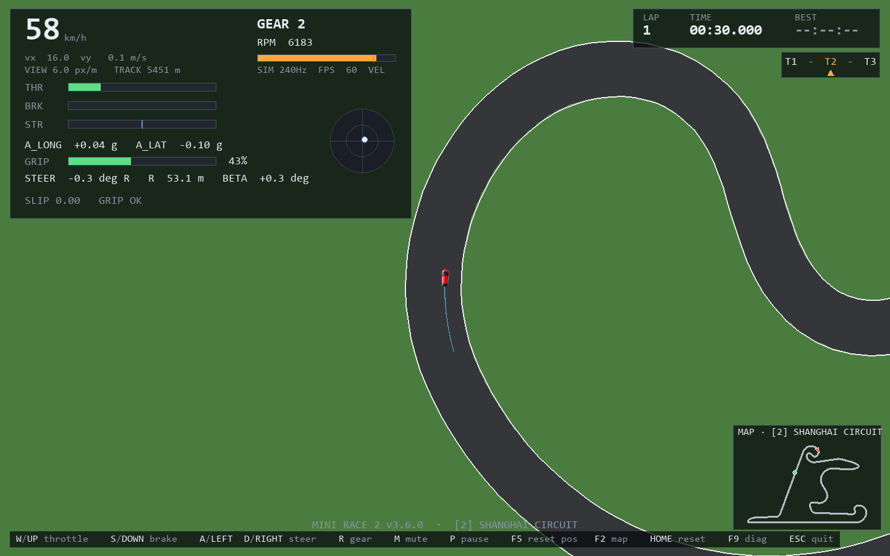

## 赛道与相机（V3.0/V3.1）

- **七张地图**（`F2` 按编号 0→6 循环切换，启动时默认加载**上次退出的地图起点**）：
  - **0 · 圆形试车场**（`cfg/tracks/track_circle.json`）：直径 **400 m** 的圆形空地，
    内部一圈直径 **360 m** 白色虚线（只是参考线，**不是墙**），只有最外侧半径 200 m 是墙；
    起点在圆心正上方（朝左，逆时针）。场地内可自由开，撞最外圈才沿墙滑动。
  - **1 · 椭圆赛道**（`cfg/tracks/track_oval.json`）：两段 **1000 m 直道** + 两端直径 **800 m**
    半圆（外边界），宽 **25 m**，圈长 **4434.7 m**；只有 **T1（右半圆）/ T2（左半圆）** 两个弯；
    起点在 T1 前直道从 T1 往回 **1/3** 处。
  - **2 · 上海国际赛车场**（`cfg/tracks/track.json`）：全长 **5451 m**，见下方尺寸。
  - **3 · 宝山卡丁车场**（`cfg/tracks/track_baoshan.json`）：由卫星图提取，中心线 **1264 m**，宽 **18 m**。
  - **4–6 · 自动赛道 01–03**（`cfg/tracks/track_auto_01..03.json`）：由 `scripts/build_random_track.py` 生成，
    圈长 1231–1796 m，宽 15.4–19.1 m，8 个弯（约束范围 8–12）；种子和全部边界条件记录在各自 JSON 的
    `reference.generator` 及 [auto_tracks_manifest.json](cfg/tracks/auto_tracks_manifest.json)。
  - 上次地图记录在 `data/last_map.json`（不入库）；损坏/缺失时回退 `maps.default`。
- **F2 选图提示**：切换地图后，右下角缩略图上方显示该图信息：
  `MAP [编号] 名称`、`LENGTH 全长 m`、`BEST 最快圈`；没有记录时显示 `--:--:--`。
  圆形试车场不显示 LENGTH/BEST（没有圈数概念）。
- **F5 就近重置**：放到离当前位置最近的当前赛道中心线点，朝向沿赛道前进方向，速度/横摆清零；
  **圆形试车场特殊设定：F5 直接回到起点**。`HOME` 仍是回到该地图起点。
- 上海赛道几何来自 `images/track.jpg`：用 `scripts/build_track.py` 做图像处理生成
  `cfg/tracks/track.json`（中心线/左右边界/起点）。关键尺寸按题目给定：
  整体比例尺按**真实圈长 5451 m** 标定、赛道宽 **15 m**、
  起点在 **T16-T1 直道从 T1 端往回约 1/3 处**、方向按弯道编号 **T1→T2→…→T16**。
  本次生成结果：整体比例尺按 **真实圈长 5451 m** 标定（1.14343 m/px），
  **1363** 个中心线点，世界包围盒约 **1340 × 865 m**（远大于 1440×900 窗口）；
  示意图中 T13-T14 直道按该比例约为 1180 m（题目给定 1135 m，记录在 `reference` 中）。
- **右上角计时面板**：上海赛车场显示 `LAP / TIME / BEST`；圆形试车场没有圈数，只显示当前时间。
  圈速在起跑线由后向前穿越时判定，最快圈按地图保存在 `data/last_map.json` 里。
- **右上角 5 要素弯道窗口**：在弯中显示如 `T1 - T2 - T3`（中间弯橙色高亮），
  在直道显示 `- T2 - T3 -`（中间短横线橙色高亮）；小三角始终指向中间要素，窗口随车滚动。
  弯/直道按中心线曲率阈值划分；同向组合弯在最小曲率点留出最小直道，反向 S 弯按阈值分开。
- **右下角缩略图**（不旋转）：画赛道形状、绿色起点、红色自车三角（方向随车头）；
  尺寸在 `render.minimap` 配置。
- 相机（`minirace/camera.py::ChaseCamera`）：
  - 车**始终在屏幕正中**（实际 0 偏移，满足要求里的 ±10% 容差）；
  - 屏幕上方 = **车的实际世界速度方向**（不是车头朝向）；倒挡时相机翻转 180°
（速度向量朝下、车头朝上），
    画面不翻转；车头与速度的夹角（β）自然表现为车身相对屏幕的横滑角；
  - 角度采用最短路径插值 + 角速度上限，跨 ±180° 连续，不会整圈翻转；
  - 速度低于 `track.camera.freeze_speed`（默认 1.5 m/s）时**冻结角度**，避免低速抖动。
- T6 发夹弯：`build_track.py` 只在 T6 附近做局部平滑（余弦权重滑动平均），白边不再有明显锯齿。
- 碰撞（`minirace/track.py`）：上海按"中心线 ± width/2"；圆形场地按"最外圈半径"；
  越界时推回边界并**去掉法向速度、保留切向速度**，沿墙滑动，不瞬间停车、无车损。
  撞墙会写 `telemetry.wall_hit`，诊断模式记为 `WALL_HIT`。
- 配色：草绿背景 / 深灰沥青 / 白色边界线 + 白色起跑线；轨迹线亮青色。

| 参数 | 默认 | 含义 |
|---|---|---|
| `track.enabled` | true | 是否用赛道模式（false 退回旧版矩形场地） |
| `track.file` | 当前地图文件 | 赛道几何文件（由 maps 列表切换） |
| `maps.list` | circle / oval / shanghai / baoshan / auto_1..3 | 地图定义（编号 0–6、名称、文件、缩放） |
| `maps.default` / `session_file` | shanghai / `data/last_map.json` | 无上次记录时的默认地图 / 上次地图记录（不入库） |
| `track.camera.pixels_per_meter` | 6.0 | 赛道相机缩放（px/m），只影响画面 |
| `track.camera.freeze_speed` / `angle_rate` / `max_angle_rate` | 1.5 / 5 / 6 | 低速冻结阈值 / 角度平滑 / 最大角速度 |
| `track.wall_slide_drag` / `wall_margin` | 0.3 / 0.02 | 贴墙滑动衰减 / 车体离墙余量 |
| `render.minimap.enabled` / `width` / `height` / `margin` | true / 240 / 170 / 14 | 右下角缩略图开关与尺寸 |

- 重建上海赛道：`python scripts/build_track.py`；重建圆形试车场：
  `python scripts/build_track.py --circle`（构建期需要 numpy / scipy / Pillow / opencv；
  运行期仍只需要 Python 标准库 + pygame）。详细流程见
  [`docs/赛道与相机.md`](docs/赛道与相机.md)。
- 世界/像素仍然解耦：物理、遥测、性能报告只认米；窗口大小、相机缩放和旋转都不影响物理
  （`tests_physics.py` 的像素无关断言仍然有效）。

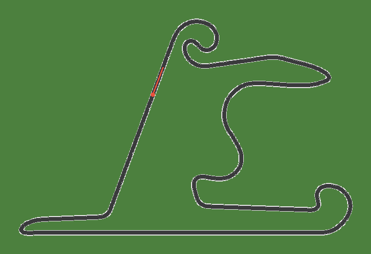

*由 `images/track.jpg` 生成的赛道全图：白色为边界，红色标记为起点与出发方向。*

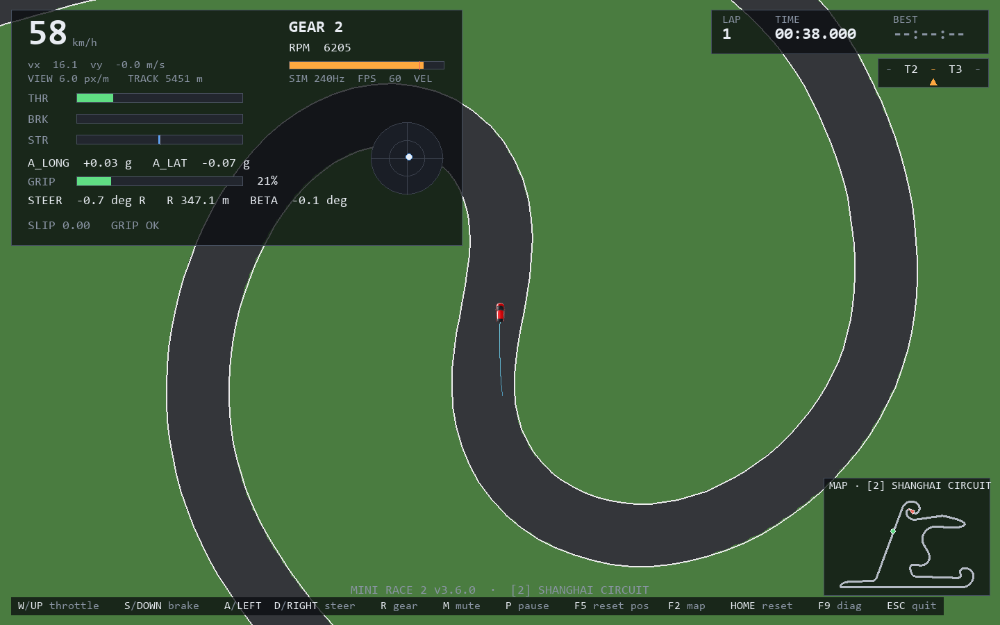

*T1 发夹弯前的画面：车固定屏幕正中、速度朝上，赛道随车头/速度方向旋转；右下角是缩略图。*

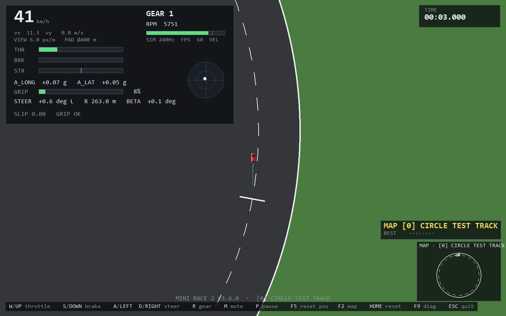

*圆形试车场：Ø400 m 空地，Ø360 m 白色虚线只是参考线，只有最外圈是墙；起点在顶部。*

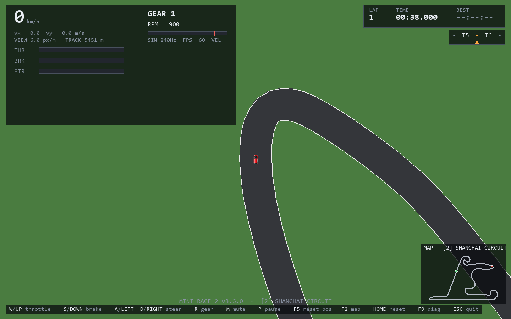

*上海 T6 发夹弯：该段中心线做了局部平滑，白色边界不再有锯齿/硬折角。*

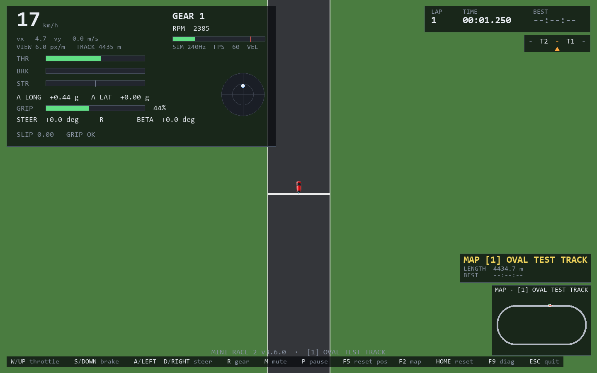

*椭圆赛道（地图 1）：2×1000 m 直道 + 2 个 Ø800 m 半圆，宽 25 m；右上角 5 要素弯道窗口。*


*F2 选图提示：地图编号/名称、全长、最快记录；没有记录显示 `--:--:--`。*

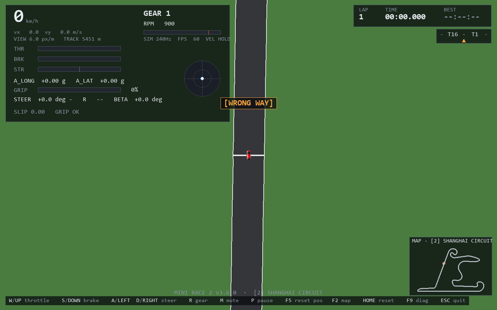

*车头与中心线方向夹角 >120° 持续 1.5 s 后，橙色 [WRONG WAY] 显示 1 s / 消失 1 s，并伴提示音。*

## 3D 显示原型（V3.14，Panda3D）

`01_Run.bat` 进入后先选择 **1. 2D interface（默认）** 或 **2. 3D interface**。

物理层完全不动，3D 只负责显示；需要 Python 3.8 + Panda3D（`pip install panda3d`）。

```bat
03_Run3D.bat
python scripts\main3d.py --map shanghai
python scripts\main3d.py --map oval --screenshot data\3d_oval.png
```

- 路肩：截面 0.4 m × 1.2 m，从赛道边界向外延伸，红白相间，单色段 ≤5 m；
- 上海弯心柱：曲率极值的内侧路肩上，直径 **0.24 m**、高 **2 m** 的红白红柱（V3.14 起尺寸 ×2）；
- 弯心柱数量：每弯由 `track.reference.corner_post_count` 控制，默认 **1 根**，`0` 表示不显示；可在 `05_AnnotateTrack.bat` 的“每个弯心的柱子数量”里设置；
- 椭圆/上海起点龙门架：横梁底部离地 4 m；
- 圆形场地：Ø360 m 白色虚线参考圆 + 起点黑白格（纯视觉）；
- 右下角缩略图：360×255（2D 的 1.5 倍）、世界北向朝上；
- 声音：发动机/打滑沿用 2D，换挡与撞墙声由共享 `Audio` 播放，`M` 静音；
- 右上角 LAP/TIME/BEST 下方显示 5 要素弯道窗口（中间橙色 + 小三角）；
- 逆行时显示闪烁 `[WRONG WAY]` 并响提示音（椭圆/上海有效，圆形场地无此判定）；
- 起点黑白格有纵向宽度，正向先靠近的近边缘就是现有计时判定线；
- `C` 切换车尾追车/车头前视，`F2` 切图，其余驾驶键同前。

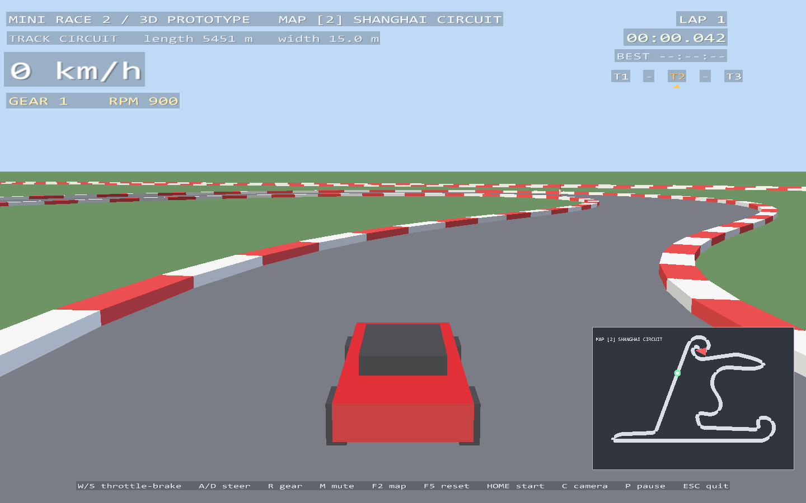

*上海 3D 视角：红白路肩与弯心柱，物理/碰撞完全不变。*

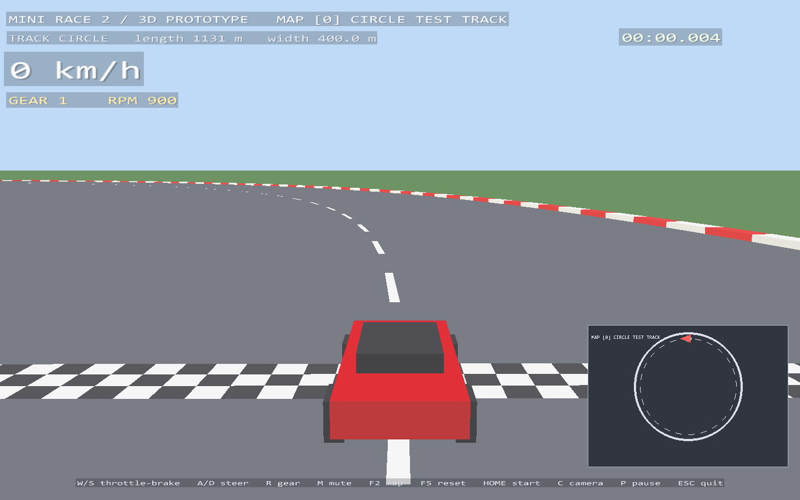

*圆形试车场：Ø360 m 虚线参考圆 + 起点黑白格（纯视觉）。*

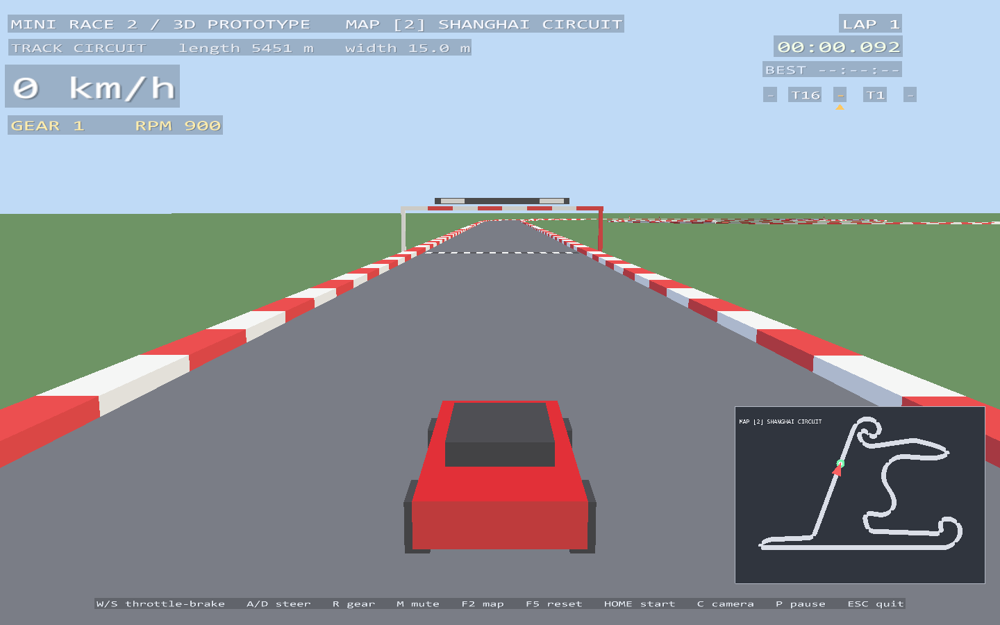

*起点龙门架、黑白格起点线和追车相机。*

详见 [docs/3D原型.md](docs/3D原型.md)。

## 调参控制台（V2.1 新增）

双击 **`02_Tune.bat`**（或 `python scripts/tune_panel.py`）打开 tkinter 控制台：

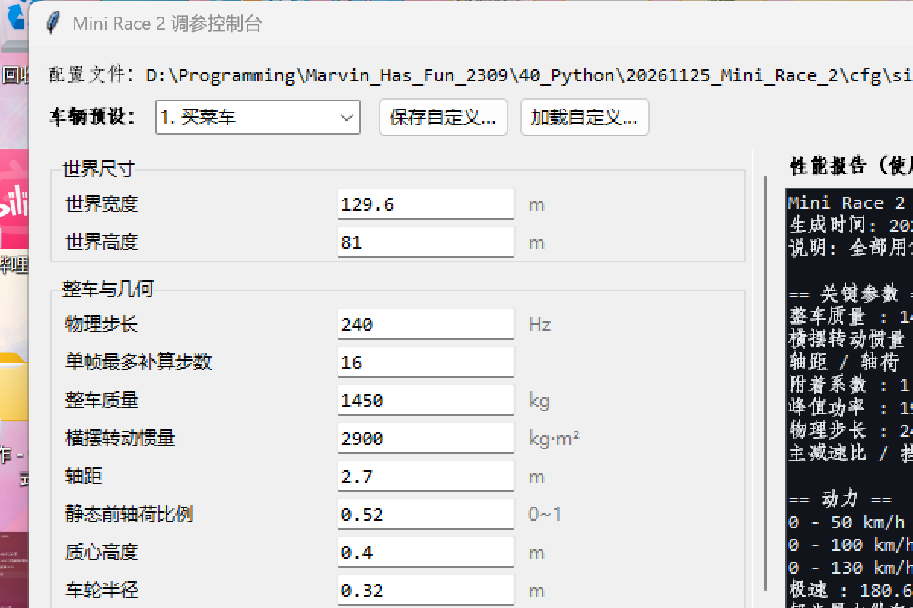

- 左侧编辑 `cfg/sim.json` 里**所有与性能/世界相关的参数**（world / vehicle / tires /
  drivetrain / engine / aero / brakes / controls，共 54 项，含齿比列表与扭矩曲线表）；
  window / render / scale / audio / version / **track（赛道与相机）** 不在这里改。
- 「运行性能测试」用**当前面板参数**跑一组固定用例（不保存文件），右侧显示报告；
  打开控制台时会自动先跑一次，方便对照。
- 「保存参数」写回 `cfg/sim.json`；**关闭窗口时会弹窗询问是否保存**
  （是 = 保存并退出 / 否 = 直接退出 / 取消 = 回到控制台）；参数解析或物理自洽性校验失败会
  弹窗并拒绝保存。
- 「保存报告」把最近一次报告另存到 `data/benchmark_*.txt`。
- **车辆预设（V3.6）**：顶部下拉框可选 **1 买菜车 / 2 性能车 / 3 超跑 / 4 自定义**；
  性能车已按保存版本调参，峰值功率约为买菜车的 **1.25 倍（244 kW）**，
  100-0 制动约 **35.5 m**；7 挡齿比 3.10 / 2.50 / 2.01 / 1.62 / 1.31 / 1.05 / 0.85；
  性能车质量 1350 kg、横摆转动惯量 **2400 kg·m²**（V3.18 调整，参考 [转动惯量计算](docs/转动惯量计算.png)）；
  性能报告使用 **6.0 km** 虚拟大场地。
  超跑当前只是 **8 挡占位**（3.10/2.58/2.14/1.78/1.48/1.23/1.02/0.85），其余参数仍是买菜车。
  预设 1-3 只能加载，不能在 GUI 里改文件；手动修改任一性能参数会自动切到 4 自定义。
  自定义可用「保存自定义…」「加载自定义…」保存/加载多个 JSON（默认 `cfg/vehicles/`）。
- 不想开 GUI 时：`python scripts/benchmark_report.py [--save]` 直接打印同一份报告。

性能用例（`scripts/minirace/benchmark.py`，headless、约 0.3 s 跑完）：

- 动力：0→50/100/130 km/h、极速与达到时间、起步最大纵向加速度、打滑时长
- 制动：100→0、极速→0 的时间/距离/平均 g
- 抓地：40~120 km/h 半舵过弯扫描，最大横向加速度
- 转弯：几何最小半径、低速实测半径、100 km/h 满舵半径
- 发动机制动：60 / 100 km/h 松油门 1 s 的平均减速度
- 传动：各挡总齿比与红线车速
- **CPU 负载**：单步物理耗时、每秒可算步数、当前 step_hz 下的单核占用与实时余量、
  留给渲染/音频后（单核 50% 预算）还能支撑的物理步长——动力学变复杂后用它判断
  240 Hz 内置时钟是否还跟得上

## 旧版矩形场地（fallback，`track.enabled=false`）

V3.0 默认在赛道上跑；把 `cfg/sim.json` 的 `track.enabled` 设为 `false` 会退回 V2.2 的
矩形场地模式，方便对比/复现旧实验：

- 世界大小在 `world.width_m / height_m`（默认 129.6 × 81 m）用米给出，物理/遥测只认米；
- 渲染用 `render.pixels_per_meter` 缩放、`render.follow_car` 决定是否跟随车辆；
- 背景贴图会按世界矩形拉伸，车 sprite 按真实车长（4.5 m）缩放；
- 撞窗口四边仍是旧的"位置钳住 + 速度清零"占位实现。

| 参数 | 默认 | 含义 |
|---|---|---|
| `world.width_m` / `height_m` | 129.6 / 81.0 | 矩形场地尺寸（米），与窗口无关 |
| `render.pixels_per_meter` | 11.111 | 旧版显示缩放（px/m，仅 fallback 用） |
| `render.follow_car` | true | 旧版相机是否跟随车辆 |

## V2.0 新增

| 项目 | 内容 |
|---|---|
| 侧偏/滑移 | 前后轴各一个等效轮胎，线性侧偏角 → 简化魔术公式（有峰值、过峰值会衰减）+ 摩擦圆截断；能出现推头/侧滑/驱动轮打滑 |
| 质量/转动惯量 | 整车 **1450 kg**、横摆转动惯量 **2900 kg·m²**，平面 2 自由度动力学（V3.3 调参） |
| 车身中心 vs 后轴 | 质心在车身中心，前/后轴距由轴距与前轴荷比例算出（a=1.30 m / b=1.40 m），不再用"后轴中心近似" |
| 载荷转移 | 纵向载荷转移（用质心高度），以及轮胎载荷敏感性（重载时单位载荷抓地力下降） |
| 发动机 | 外特性扭矩曲线（峰值 **357 N·m @4500 rpm**，峰值功率约 **195 kW**）、内摩擦（松油门就是发动机制动）、怠速控制器（900 rpm） |
| 传动 | 自动挡 **6 前进挡 + 1 倒挡**，齿比 / 主减速比 / 换挡转速 / 换挡断油时间 / 换挡间隔全部可调；低速起步离合打滑 |
| 声音 | 默认程序化生成：32 档发动机音色按转速交叉淡化，打滑时叠加尖叫音；`M` 静音；没有声卡时自动静音。可选**采样包**：`sounds/` 里有 WAV 时自动挑平稳段做循环并变调（素材不入库，见“音频素材”） |

> 你在 V1 里把 `power` 调到 18000（≈175 kW）后觉得手感不错；V2 用扭矩曲线 + 齿比取代了
> `power`，默认峰值功率约 **195 kW**（V3.3，1450 kg），动力水平基本对齐；极速由 6 挡齿比
> /红线限制在约 **180 km/h**（默认赛道圈长 5451 m；世界尺寸、显示缩放、镜头都可以单独调整，
> 见上一节）。

## 快速开始

双击 **`01_Run.bat`**。它会自动寻找**装了 pygame 的 Python**，优先使用：

- `D:\Programming\Python_dir_38\python.exe`（Python 3.8 + pygame 2.6.1，本机已验证）
- `D:\Program Files\Python36\python.exe`（Python 3.6 + pygame 2.0.0，本机已验证）
- 其余常见安装路径，最后回退到 `where python` / `py -3`

换机器时编辑 `01_Run.bat` 顶部的候选列表。也可以手动：

```bat
"D:\Programming\Python_dir_38\python.exe" scripts\main.py
```

要求：Python 3.6+ 且已安装 pygame（`python -m pip install pygame`）。
物理/配置/存储都是纯标准库；只有渲染和音频用 pygame。

## 操作

| 按键 | 功能 |
|---|---|
| `W` / `↑` | 油门（0.9 上限，约 0.5 s 踩到底） |
| `S` / `↓` | 刹车（0.8 上限，约 0.45 s 踩到底） |
| `A` / `←`、`D` / `→` | 左 / 右打方向（约 0.5 s 打满，松手回正） |
| `R` | 换挡：D ⇄ R（**只在接近停车时**；前进挡内部是自动挡） |
| `M` | 静音 / 取消静音 |
| `-` / 小键盘 `-` | 缩小显示倍率（远，最多 -3） |
| `=` / 小键盘 `+` | 放大显示倍率（近，最多 +3，2×） |
| `F5` | 复位到最近中心线（圆形试车场：直接回起点），速度清零；**不重置单圈时间** |
| `F2` | 切换地图（0 圆形 → 1 椭圆 → 2 上海 → 3 宝山 → 4–6 自动赛道），从该地图起点开始 |
| `F9` | 诊断模式开/关（逐步写 `data/diag_*.csv`，关闭时生成异常摘要） |
| `P` | 暂停 / 继续 |
| `Home` | 车辆复位到当前地图起点；**圈数 +1，丢弃上一圈用时** |
| `Esc` | 退出 |

HUD 显示：速度（km/h + vx/vy）、**挡位与转速（带转速表/红线）**、踏板与方向盘、
实际纵/横向加速度（g）、附着利用率、实际前轮转角/转弯半径、车身侧偏角 BETA、
打滑状态（WHEELSPIN / LOCKUP / SLIDE）和摩擦圆示波器（V3.7 起方向翻转：前→后、左→右）；`VIEW` 后显示当前显示倍率 `(+1)` 等，默认 0 档不显示；右上角是圈速面板
（上海：LAP / TIME / BEST；圆形试车场：只有 TIME）；下方是 5 要素弯道窗口。

显示倍率只在本次窗口内有效：F2 切图、F5、HOME 都会保留当前档位；关闭窗口/重新启动后回到默认 0 档。

车头与中心线方向夹角超过 **120°** 并持续 **1.5 s** 后，屏幕中心偏上 1/3 处会显示闪烁的
橙色 `[WRONG WAY]`（显示 1 s / 消失 1 s，同时 beep），车头回正后立即消失并重新计时。

底部按键说明会**高亮当前按下的键**（绿色），诊断模式下右上角显示红色 `● DIAG REC`。

## 诊断模式（V2.4 新增）

用来抓"奇怪现象"：`python scripts/main.py --diagnose` 启动即开启，或游戏中按 `F9` 随时开/关。

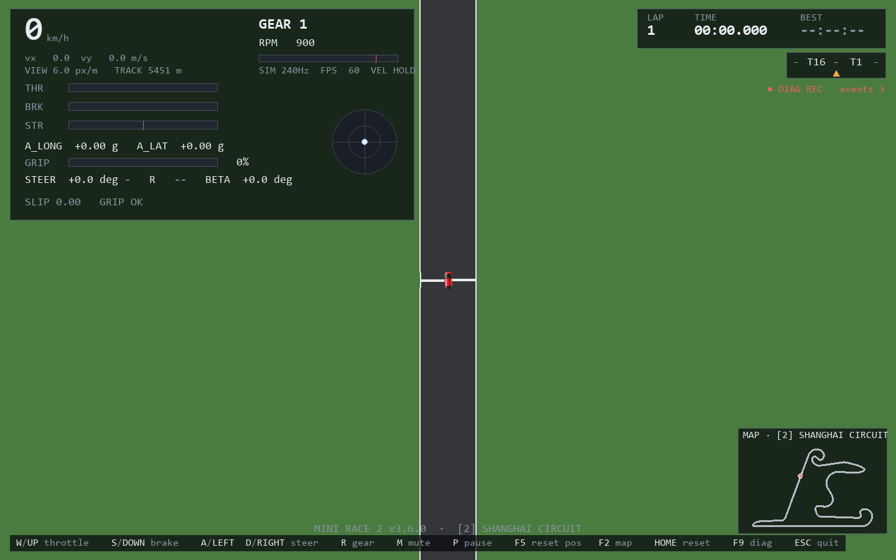

- 开启后**每个物理步**写一行 `data/diag_YYYYmmdd_HHMMSS.csv`（完整 Telemetry，
  最后一列 `events` 是当步异常标记）；关闭/退出时自动生成
  `data/diag_..._summary.txt`。
- 自动标记的异常（阈值在 `cfg/sim.json` 的 `diagnostics` 段可调）：
  - `NAN`：任何数值状态出现 NaN/Inf；
  - `SPEED_JUMP`：单步速度变化率超过 50 m/s²；
  - `HEADING_JUMP`：单步航向变化率超过 20 rad/s；
  - `GEAR_HUNT`：2 秒内换挡 ≥4 次；
  - `WALL_HIT`：撞到赛道边界（每个连续碰撞过程记一次；沿墙滑动不会清零速度）；
  - `GRIP_SATURATED`：轮胎连续打滑/侧滑（`sliding / wheelspin / lockup` 或
    `slip_amount` 超阈值）持续 ≥1 秒；
  - `YAW_RUNAWAY`：没有转向输入（`|steer|` 很小）时横摆角速度仍 ≥2 rad/s 并持续
    ≥0.5 秒（自旋/螺旋的特征——这次倒挡 bug 就是靠它抓到的）。
- 摘要包含：各事件计数、最高车速/最大纵向/横向加速度/最高转速、换挡次数、
  打滑步数、最近 20 条异常事件（时间 + 细节）。
- 注意逐物理步 CSV 体积不小（240 Hz 下约 100 KB/s），只在需要复现问题时开。

## 关键参数（`cfg/sim.json`）

| 分组 | 参数 | 默认值 | 含义 |
|---|---|---|---|
| `vehicle` | `mass` / `inertia` | **1450 kg / 2900 kg·m²** | 质量 / 横摆转动惯量 |
| | `wheelbase` / `front_weight_fraction` | 2.70 m / 0.52 | 轴距 / 静态前轴荷比例 |
| | `cg_height` | 0.40 m | 质心高度（纵向载荷转移用） |
| | `wheel_radius` | 0.32 m | 车轮半径 |
| | `max_steer_deg` | 33.5° | 最大前轮转角（几何最小半径 4.08 m） |
| | `step_hz` | 240 Hz | 物理步长（轮胎动力学需要更细的步长） |
| `tires` | `friction` | 1.10 | 附着系数（极限约 1.10 g） |
| | `cornering_stiffness` | 16 /Fz | 侧偏刚度系数（按轴合计） |
| | `tire_shape` | 1.6 | 魔术公式形状因子（决定峰值侧偏角，约 9.4°） |
| | `load_sensitivity` | 0.10 | 载荷敏感性 |
| | `scrub_speed` / `scrub_yaw_damping` / `scrub_lateral_damping` | 1.2 m/s / 8 /s / 10 /s | 低速轮胎蹭地阻尼（模拟静态摩擦，防止刹停后原地自转） |
| `drivetrain` | `gear_ratios` | 3.10 / 2.35 / 1.85 / 1.55 / 1.32 / **0.85** | 6 个前进挡齿比（第 6 挡为超速挡，红线约 180 km/h） |
| | `final_drive` | 5.50 | 主减速比 |
| | `reverse_ratio` | 3.20 | 倒挡齿比 |
| | `drive_split_front` | 0.50 | 驱动分配（0=后驱，1=前驱，0.5=四驱） |
| | `idle_rpm` / `redline_rpm` | 900 / 7000 | 怠速 / 红线 |
| | `shift_up_rpm` / `shift_down_rpm` | 6700 / 2500 | 自动升/降挡转速 |
| | `kickdown_rpm` | 3300 | 大油门低转速降挡阈值 |
| | `shift_time` / `shift_interval` | 0.18 s / 0.30 s | 换挡断油时间 / 两次换挡最小间隔 |
| `engine` | `torque_curve` | `[[1000,235],...]` | 发动机外特性（线性插值，峰值 357 N·m @4500） |
| | `friction_base` / `friction_per_rpm` | 16 / 0.005 | 内摩擦（发动机制动来源） |
| `brakes` | `decel_limit` / `front_bias` | **13.5 m/s²** / 0.62 | 刹车目标减速度 / 前轴制动力占比 |
| `audio` | `enabled` / `master_volume` | true / 0.35 | 音频总开关 / 总音量 |
| | `sample_pack.engine_file` | `sounds/Car_Engine_Gear_Shift_Hum_Loops/soundza-car-engine-loop-1.wav` | 怠速循环 WAV |
| | `sample_pack.run_engine_files` | `loop-8.wav`~`loop-13.wav` | 运行组 6 段，按 RPM 交叉淡化 |
| | `sample_pack.shift_file` | `sounds/.../soundza-gear-shift-1.wav` | 换挡声 |
| | `sample_pack.run_engine_frequencies` | `[73.5, ...]` | 运行素材主频，用于生成按 RPM 正比的音高表 |
| | `sample_pack.pitch_steps` | 64 | 音高表档数（越大越平滑，内存/启动换） |
| | `sample_pack.idle_pitch_factor` | 0.95 | 怠速采样变调系数 |
| | `sample_pack.crash_volume` | 0.85 | 撞墙合成声音量 |
| `audio.startup_delay_s` / `fade_in_s` | 0.6 / 0.4 | 开局先静音 0.6 s，再用 0.4 s 淡入 |
| | `sample_pack.loop_seconds` / `base_rpm` | 4.0 s / 2400 | 旧单文件模式下的循环长度 / 采样转速 |

### 实测（`python scripts/probe_physics.py`）

- 峰值功率约 **195 kW**，极速 **180.6 km/h**（6 挡 0.85，红线 7000 rpm）
- 0→50 km/h **2.23 s**，0→100 km/h **6.27 s**，0→130 km/h 10.23 s
- 100→0 刹停 **2.78 s / 42.0 m**（平均 1.02 g）；极速→0 **4.79 s / 124.7 m**
- 发动机制动：60 km/h（2 挡）松油门 **1.39 m/s²**；100 km/h（5 挡）**1.00 m/s²**
- 稳态过弯：约 1.0 g 横向加速度；在 107 km/h 打 8.4° 时 R≈45 m 稳定，
  全舵则只给到约 0.7 g（明显推头），不再像 V1 那样"高速反而更咬地"
- 起步大油门会触发驱动轮打滑（WHEELSPIN + 打滑声）

## 音频素材（可选采样包）

默认**不需要任何音频文件**：没有 `sounds/` 时，发动机用标准库合成 32 档音色，
打滑声也由程序合成，克隆仓库即可运行。

本机当前配置使用 Soundza 的
[Car Engine, Gear Shift & Hum Loops](https://soundza.com/packs/car-engine-gear-shift-and-hum-loops)
（CC0 素材包，含 13 段引擎循环、13 段换挡/手刹音）：

- 怠速：`soundza-car-engine-loop-1.wav` 循环（0.95× 变调，贴近 900 rpm）；
- 运行：`soundza-car-engine-loop-8.wav` ~ `loop-13.wav` 六段作为音色素材，
  按 RPM 目标点火频率 `rpm/30` 生成 64 档音高表，再在相邻档之间交叉淡化；
- 换挡：检测挡位变化，播放 `soundza-gear-shift-1.wav` 一次；
- 打滑：采样包没有合适胎噪，继续使用原来的合成尖叫音；
- 撞墙：程序合成低频“砰”声，音量参考碰撞前速度，带 0.35 s 冷却。

`cfg/sim.json` 的分组配置：

```json
"audio": {
  "startup_delay_s": 0.6,
  "fade_in_s": 0.4,
  "sample_pack": {
    "enabled": true,
    "engine_file": "sounds/Car_Engine_Gear_Shift_Hum_Loops/soundza-car-engine-loop-1.wav",
    "run_engine_files": [
      "sounds/Car_Engine_Gear_Shift_Hum_Loops/soundza-car-engine-loop-8.wav",
      "sounds/Car_Engine_Gear_Shift_Hum_Loops/soundza-car-engine-loop-9.wav",
      "sounds/Car_Engine_Gear_Shift_Hum_Loops/soundza-car-engine-loop-10.wav",
      "sounds/Car_Engine_Gear_Shift_Hum_Loops/soundza-car-engine-loop-11.wav",
      "sounds/Car_Engine_Gear_Shift_Hum_Loops/soundza-car-engine-loop-12.wav",
      "sounds/Car_Engine_Gear_Shift_Hum_Loops/soundza-car-engine-loop-13.wav"
    ],
    "shift_file": "sounds/Car_Engine_Gear_Shift_Hum_Loops/soundza-gear-shift-1.wav",
    "run_engine_frequencies": [73.5, 82.5, 92.5, 104.0, 116.5, 131.0],
    "run_loop_seconds": 1.5,
    "pitch_steps": 64,
    "idle_pitch_factor": 0.95,
    "target_peak": 0.55,
    "crash_volume": 0.85
  }
}
```

- 游戏开局先静音 `startup_delay_s`（默认 0.6 s），再用 `fade_in_s`（默认 0.4 s）淡入，避开启动瞬间的爆音；
- 支持未压缩 PCM WAV（8/16/24/32-bit，单/多声道，任意采样率）；程序自动混成单声道并重采样到混音器采样率；
- 分组模式会按 RPM 目标频率重采样：目标点火频率 `rpm/30`，用 8~13 段中自然频率
  最接近的素材作为音色源，再生成 64 档音高表，因此低转更低、高转更高；
- 64 档相邻档之间约 3.6% 频率差；切换时只替换不在目标集合里的 voice，另一个 voice 继续发声，避免两路同时重启造成断续；
- `run_engine_frequencies` 是 8~13 段的实测主频，用于选源和变调；`idle_pitch_factor` 是怠速变调系数；
- 如果把 `run_engine_files` 留空，会回退到旧的单文件模式（自动挑平稳段 + 32 档变调）；
- 文件缺失/格式不支持时自动回退到程序化合成声，不影响启动；
- **`sounds/` 已加入 `.gitignore`，素材不随代码提交**。本机素材来源/许可说明见
  [`docs/音频素材与许可.md`](docs/音频素材与许可.md)。

## AI 驾驶员（V3.19）

驾驶接口定义在 `scripts/minirace/driver.py`：

```python
driver.reset(track)
command = driver.decide(observation)   # DriveCommand(throttle, brake, steer)
```

- 观测量由 `Driver.observe(simulation)` 生成，AI 不依赖键盘回弹模型；
- AI 用 `Simulation.step_raw()` 直接给连续控制量；
- 默认 **AI 决策 60 Hz**，车辆物理仍是 240 Hz。

当前的规则驾驶员 `RuleDriver`：

- 转向：中心线纯追踪（随速度变长的前视点）；
- 速度：沿前方约 90 m 预扫描曲率，按 `v² = v_corner² + 2·a_brake·s`
  提前制动；
- 参数在 `cfg/ai.json`，可用 **`04_TuneAI.bat`** 的 tkinter 面板修改：
  AI 数量、决策频率、发车间距、前视距离/时间、转向增益、方向盘速率、
  目标横向加速度、规划制动减速度、最高目标速度、油门/刹车增益。

多 AI：

- `cfg/ai.json` 的 `count` 默认 **1**，可调 0~64；
- 每个 AI 拥有独立 `Simulation`，**AI 之间没有车-车碰撞**，可以互相穿过；
- 每个 AI 只与环境边界（赛道墙）碰撞；
- 2D/3D 都会显示 AI 车辆（2D 彩色多边形/缩略图标记，3D 彩色车模）；
- 2D/3D 右上方名次表（最多 4 行：第一名 + 玩家前后；圆形不显示）：
  领先 AI 的差距为负（`-100m` / `-1LAP`），落后为正（`+40m` / `+1LAP`），
  距离按“已完成圈数 × 圈长 + 当前圈沿中心线里程”计算，不按累计行驶里程；
  `Player` 自己显示 `--`；第三列是最快单圈；
- 3D 每辆 AI 上方显示 `AI_01`/`AI_02` 标签，3D 缩略图显示所有 AI 位置；
- 3D 按住 `B` 时摄像头绕车辆中心转到车前向后看，松开恢复正常视角（2D 无此功能）；
- AI 车辆固定配色（`minirace/ai_colors.py`，超过 10 个循环使用）：
  红、黄、鲜绿、蓝、品红、橙、青、深蓝、浅灰、白；绿色特意选高亮鲜绿，和草地分开。
- `04_TuneAI.bat` 的“运行 AI 算力测试”会从上海赛道 headless 跑闭环，
  给出每帧 AI 计算耗时、60 fps 预算、单核占用和剩余算力/可支持 AI 数量。

多车同场测试（10 个 AI，颜色按红/黄/绿/蓝/品红/橙/青/深蓝/浅灰/白循环）：

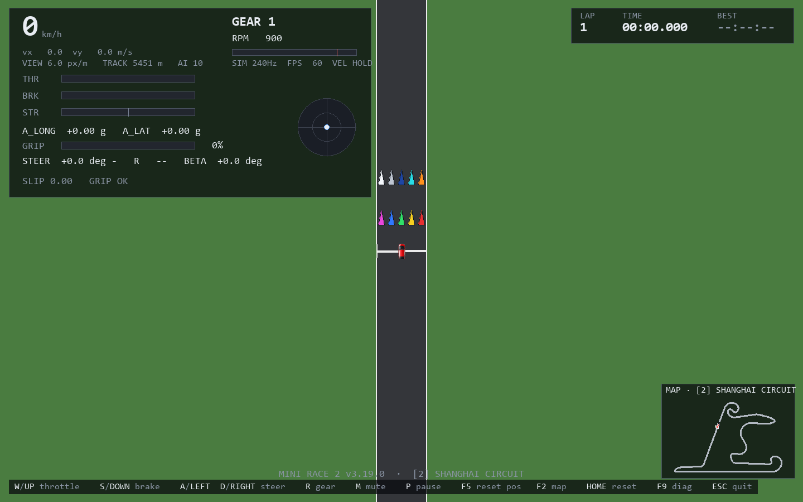

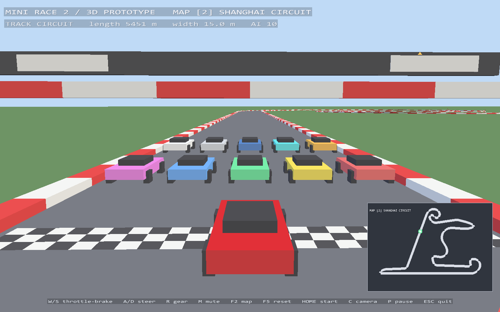


## 自动生成赛道（V4.0）

生成脚本：[scripts/build_random_track.py](scripts/build_random_track.py)，默认生成 3 条：

```bat
python scripts\build_random_track.py --seed 20261126 --count 3
```

边界条件全部是参数（圈长 1200–1800 m、宽度 15–25 m、弯数 8–12、最长直道 300 m、
发卡弯边界曲率 ≥0.12 1/m、边界曲率上限 0.30 1/m）：

```bat
python scripts\build_random_track.py ^
  --lap-min 1200 --lap-max 1800 ^
  --width-min 15 --width-max 25 ^
  --corner-min 8 --corner-max 12 ^
  --min-straight 12 ^
  --min-longest-straight 0 ^
  --max-straight 300 ^
  --hairpin-turn-angle-deg 135 ^
  --hairpin-min-count 1 ^
  --max-left-right-diff none ^
  --boundary-curvature-max 0.30
```

- `--min-straight 12`：**所有**直道的最小长度；
- `--min-longest-straight`：只限制**最长直道**不得短于该值，`0`=关闭；
- `--max-straight`：**所有**直道的上限，`0`=关闭；
- `--hairpin-min-count` 是参数：默认 **1**；设为 **0** 相当于关闭发卡数量要求；
  设得更大时会要求更多高曲率弯，数量超过可行范围时会明确报错；
- `--max-left-right-diff`：`|左弯数-右弯数|` 的上限；
  `0`=左右弯数量必须严格相等；`none`=不限制（默认）。
  设成很小的值可能因为赛道路径约束而生成失败。

06 生成面板另有：

- `Use random seed`：勾选后忽略 Seed 输入框（输入框变灰），每次生成使用随机种子；
  实际使用的种子仍会写入赛道 JSON/种子文件，之后可关掉开关手动复现；
- `Max attempts (0=off)`：最多尝试多少个 seed；
- `Max time s (0=off)`：最多尝试多少秒；
- 两者都设 0 会直接报错，至少需要一个非 0 限制。

每条赛道 JSON 的 `reference.generator` 保存种子和全部参数；
其中 `reference.generator.version` 是**生成器独立版本号**（当前 `1.0.0`），
只有同一生成器版本的种子才保证可复现；规则变化会提升该版本号。
以后任何修改赛道生成规则或输出结构的改动，都必须同步提升 `GENERATOR_VERSION`。
`cfg/tracks/auto_tracks_manifest.json` 是三条赛道的汇总，方便复现。
中心线用 `sin²(πt)` 曲率弯 + 零曲率直道，弯内曲率有唯一极值，κ 与 dκ/ds 连续。

生成后默认再做一次后处理：

- 用严格阈值 `|κ| < 0.0015` 找直道，把直道点沿弦线拉直；
- 直道两端各 3 个点做余弦混合，过渡段归入相邻弯道，避免接点折角；
- 重建 `corners`/`elements`，自动编号 `T1..Tn`；
- 起点自动放在**整条赛道最长直道的中点**，方向由种子决定（记录 `start_direction`）；
- 生成完成后整体旋转赛道，使起点出发方向朝**正右方 +x**（`start_heading_rad=0`，`rotation_rad` 可查）；
- `corner_post_count` 默认 **1**，每个弯心 1 根柱子；
- 测试项同时检查直道最大偏差 ≤0.05 m。

## 赛道候选管理器（06_ManageTracks.bat）

双击 [06_ManageTracks.bat](06_ManageTracks.bat) 打开 tkinter 管理器：

- 启用/禁用任意赛道（只从 F2 列表暂时移除，不删除固定赛道）；
- 随机赛道可删除（同时删除 `cfg/tracks/track_*.json`）；
- 列表显示编号、ID、名称、类型、长度、宽度、弯数、最长直道、状态、
  生成器版本（非随机赛道显示 `N.A`）、种子文件名；
- 删除随机赛道只删除赛道 JSON，**保留 `cfg/seeds/` 里的种子文件**；
- 可按编号/名称/长度/宽度/弯数/最长直道排序；
- 可设置“下次启动”的起点，写入主配置 `cfg/sim.json` 的 `maps.startup`，
  不是写入管理器配置，避免两份状态；
- 输入参数生成随机赛道并直接加入候选列表。

管理器自己的状态（禁用列表、排序方式、生成参数）保存在
`cfg/track_manager.json`。启动时如果上次保存的赛道被禁用，会按原列表顺序
自动找下一条可用赛道；如果没有可用赛道，显示 `[No Available Track]` 并在
3 秒后退出。

生成随机赛道时会同时在 `cfg/seeds/` 写一个种子文件，文件名形如：

```text
seed_v1.0.0_20261126_143012_20261127.json
         ^版本    ^时间戳      ^种子号
```

种子文件保存完整生成参数，且被 `.gitignore` 忽略；06 删除赛道时保留种子文件。

最快单圈的存储键：

- 固定赛道：地图 ID（例如 `fixed:shanghai`）；
- 随机赛道：**种子文件名**（例如 `seed:seed_v1.0.0_20261126_143012_20261127.json`）。
  因此删除旧随机赛道、再生成同名/同 ID 的新赛道时，不会覆盖旧的最快圈记录。
  旧版按地图 ID 保存的记录会自动迁移。

## 自定义赛道标注（05_AnnotateTrack.bat）

双击 [05_AnnotateTrack.bat](05_AnnotateTrack.bat)，默认打开宝山赛道：

1. `Set Start / Direction`：先点起点，再点起点前方行驶方向上的一个点；
2. 然后按比赛方向依次点击弯心，自动标 `T1 / T2 / ...`；
3. 在设置栏填“每个弯心的柱子数量”（默认 1，0=不显示）；
4. `Save` 写回赛道 JSON。

也可以把想标注的图片直接拖到 `.bat` 上，再按提示输入赛道 JSON 路径。
从图片创建新地图可先跑 `scripts/build_custom_track.py`（参数见脚本头部说明），
再用本工具标注弯道和起点。

## 目录约定

沿用 `40_Python/20261121_Tractor_game` 的范式：

| 目录/文件 | 用途 |
|---|---|
| `01_Run.bat` | 启动器：控制台选择 1=2D（默认）/ 2=3D |
| `02_Tune.bat` | 启动 tkinter 调参控制台（需要 tkinter，不需要 pygame） |
| `03_Run3D.bat` | Panda3D 3D 显示原型（需要 Python 3.8 + panda3d） |
| `04_TuneAI.bat` | AI 参数/算力调参控制台（tkinter，不需要 pygame） |
| `05_AnnotateTrack.bat` | 赛道弯道/起点/柱子数量半自动标注（拖入图片或按提示输入路径） |
| `06_ManageTracks.bat` | 赛道候选管理器：启用/禁用、排序、生成/删除随机赛道、选择下次启动起点 |
| `Readme.md` | 文档总入口 |
| `scripts/main.py` | 2D 程序入口；日志写 `logs/run.log` |
| `scripts/main3d.py` | Panda3D 3D 原型入口 |
| `scripts/build_random_track.py` | 按边界条件/种子随机生成闭环赛道 |
| `scripts/track_manager.py` | 赛道启用/禁用/启动选择公共逻辑 |
| `scripts/track_manager_gui.py` | 06 赛道候选管理器 GUI |
| `scripts/tests_generated_tracks.py` | 当前随机赛道边界条件校验 |
| `scripts/tune_ai.py` | AI 调参控制台（编辑 cfg/ai.json + headless 算力测试） |
| `scripts/minirace3d/` | 3D 场景/几何/相机/HUD（不影响物理） |
| `scripts/minirace/driver.py` | AI 驾驶接口 + 规则驾驶员（纯数学） |
| `scripts/minirace/ai.py` | 多 AI 独立 Simulation/发车/闭环基准 |
| `scripts/tune_panel.py` | tkinter 调参控制台（参数编辑 + 性能报告 + 保存询问） |
| `scripts/benchmark_report.py` | 命令行版性能报告 |
| `scripts/minirace/` | 模拟器代码（动力学、输入、模拟、渲染、音频、存储、性能用例） |
| `scripts/tests_physics.py` | 物理自检（不需要 pygame，23 项） |
| `scripts/tests_track.py` | 赛道/地图/圈速/弯道窗口/相机/逆行/预设/缩放自检（纯数学，65 项） |
| `scripts/tests_audio.py` | 音频冒烟测试（需要 pygame，用 dummy 音频设备，16 项） |
| `scripts/tests_ai.py` | AI 接口/配色/名次/闭环/多 AI 独立性/起跑朝向/赛道里程自检（纯数学，11 项） |
| `scripts/tests_generated_tracks.py` | 当前随机赛道边界条件/种子/自交/中心线转角发卡数量/直道上下限/左右弯差/拉直后直道/编号/柱数/起点中点/朝向校验（64 项） |
| `scripts/tests_track_manager.py` | 启用/禁用、禁用后找下一条、无可用赛道、startup 一次性、随机赛道增删、种子文件、种子文件名圈速键/迁移（18 项） |
| `scripts/tests_diagnostics.py` | 诊断模式自检（构造速度跳变/换挡抖动/撞界/NaN/自旋等，9 项） |
| `scripts/probe_physics.py` | 标定探针：车辆/传动参数、加速、制动、发动机制动、过弯表 |
| `scripts/build_track.py` | 构建期工具：`cfg/tracks/track.json`；`--circle` 圆形；`--oval` 椭圆 |
| `docs/` | 文档（含 `赛道与相机.md`、`音频素材与许可.md`） |
| `cfg/sim.json` | 全部可调参数（含 `track`、`maps`、`diagnostics` 阈值） |
| `cfg/ai.json` | AI 数量/决策频率/规则驾驶员参数 |
| `cfg/track_manager.json` | 赛道管理器的禁用列表/排序/生成参数（起点不在这里） |
| `cfg/tracks/` | **所有赛道几何 JSON**（固定/宝山/随机/自动）及自动赛道 manifest |
| `cfg/seeds/` | 随机赛道种子 JSON（文件名=生成器版本+时间戳+种子号；**本地生成，不入库**） |
| `cfg/tracks/track.json` | 上海赛道几何：中心线/左右边界/起点 |
| `cfg/tracks/track_circle.json` | 圆形试车场：Ø400 m 空地 / Ø360 m 虚线 / 起点 |
| `cfg/vehicles/` | 车辆预设：1 买菜车 / 2 性能车 / 3 超跑；自定义存档也放这里 |
| `cfg/tracks/track_oval.json` | 椭圆赛道：2×1000 m 直道 + 2 个 Ø800 m 半圆 / 宽 25 m / T1 T2 |
| `data/` | 遥测 `run_*.csv`、性能报告 `benchmark_*.txt`、诊断 `diag_*.csv/_summary.txt`（**不入库**） |
| `sounds/` | 本地音频素材（可选采样包，**不入库**；来源/许可见 `docs/音频素材与许可.md`） |
| `logs/` | 运行日志（**不入库**） |
| `models/` | 预留：将来 AI 驾驶员的模型文件 |
| `dev_req/` | 需求记录 |
| `images/` | 素材（背景图、车贴图） |
| `Lib/` | 旧版遗留的 `Vec2d` 依赖，V1 起已不再使用，可以删除 |

## 代码结构

| 文件 | 作用 |
|---|---|
| `minirace/config.py` | 读 `cfg/sim.json`，与内置默认值深合并 |
| `minirace/vehicle.py` | 2 自由度车辆 + 轮胎 + 发动机/传动（纯数学，不依赖 pygame） |
| `minirace/controls.py` | 键盘开关量 → 连续踏板/方向盘位置（回弹、死区） |
| `minirace/sim.py` | 世界 = 车辆 + 赛道 + 输入 + 轨迹 + 时间（米）；`step()` 走输入回弹，`step_raw()` 直接给踏板/方向盘（将来 AI 用） |
| `minirace/camera.py` | 旧版相机（矩形世界）+ `ChaseCamera`（赛道：车居中、速度朝上、低速冻结） |
| `minirace/track.py` | 赛道/圆形场地几何：最近中心线点、撞墙推回/沿墙滑动 |
| `minirace/render.py` | pygame 渲染：赛道（草皮/沥青/白线/起跑线）、轨迹、车、HUD、转速表、摩擦圆 |
| `minirace/audio.py` | 发动机/打滑声音（合成音色表或 WAV 采样包 + 按转速交叉淡化） |
| `minirace/storage.py` | 遥测 CSV 录制 |
| `minirace/diagnostics.py` | 诊断模式：逐步 telemetry CSV + 异常事件标记 + 摘要 |
| `minirace/benchmark.py` | 性能测试用例与报告（headless，供调参控制台/命令行使用） |
| `minirace/app.py` | 主循环：事件、固定步长、渲染、音频、录制 |

无窗口步进（AI / 强化学习环境的接口）：

```python
import sys
sys.path.insert(0, "scripts")
from minirace.config import load_config
from minirace.sim import Simulation
from minirace.controls import Command

sim = Simulation(load_config("."))
telemetry = sim.step(Command(throttle=True, left=True))   # 开关量输入
telemetry = sim.step_raw(0.9, 0.0, 0.4)                   # 或直接给踏板/方向盘
```

## 常用命令

```powershell
# 启动 / 冒烟测试（1.5 秒后自动退出，必须有 pygame）
"D:\Programming\Python_dir_38\python.exe" scripts\main.py
"D:\Programming\Python_dir_38\python.exe" scripts\main.py --smoke

# 录制遥测到 data/run_YYYYmmdd_HHMMSS.csv
"D:\Programming\Python_dir_38\python.exe" scripts\main.py --record

# 存一帧截图后退出（无显示器/CI 可配合 SDL_VIDEODRIVER=dummy）
"D:\Programming\Python_dir_38\python.exe" scripts\main.py --capture data\shot.png

# 自检（物理/赛道/诊断不需要 pygame；音频用 dummy 设备）
"D:\Programming\Python_dir_38\python.exe" scripts\tests_physics.py
"D:\Programming\Python_dir_38\python.exe" scripts\tests_track.py
"D:\Programming\Python_dir_38\python.exe" scripts\tests_generated_tracks.py
"D:\Programming\Python_dir_38\python.exe" scripts\tests_track_manager.py
"D:\Programming\Python_dir_38\python.exe" scripts\tests_ai.py
"D:\Programming\Python_dir_38\python.exe" scripts\tests_audio.py
"D:\Programming\Python_dir_38\python.exe" scripts\tests_diagnostics.py

# 重建赛道几何（构建期需要 numpy/scipy/Pillow/opencv）
"D:\Programming\Python_dir_38\python.exe" scripts\build_track.py
"D:\Programming\Python_dir_38\python.exe" scripts\build_track.py --circle
"D:\Programming\Python_dir_38\python.exe" scripts\build_track.py --oval

# 诊断模式（逐步 CSV + 异常事件；游戏里 F9 可开关）
"D:\Programming\Python_dir_38\python.exe" scripts\main.py --diagnose

# 标定探针
"D:\Programming\Python_dir_38\python.exe" scripts\probe_physics.py

# 调参控制台（GUI）/ 命令行性能报告
"D:\Programming\Python_dir_38\python.exe" scripts\tune_panel.py
"D:\Programming\Python_dir_38\python.exe" scripts\benchmark_report.py --save
```

## 已知限制

- 圈速只有当前圈/最快圈，没有分段时间、最佳线路；AI 目前是规则驾驶员，不是强化学习对手。
- 赛道几何来自示意图，不是高精度测绘：整体圈长按真实 **5451 m** 标定，但示意图中
  T13-T14 直道会变成约 1180 m（题目给定 1135 m），个别发夹弯视觉上偏紧；
  碰撞用矩形投影近似，没有逐轮接触/车损/轮胎墙。
- 轮胎只有"侧偏角 → 侧向力"的简化曲线：没有轮胎松弛长度、没有车轮转动惯量/滑移率曲线，
  所以打滑时只做"力饱和 + 需求超限判定 + 转速近似抬升"，不是完整的轮速动力学。
- 没有横向载荷转移、没有差速器（前后轴扭矩固定分配，超出附着就丢弃）。
- 发动机/传动是"准静态"模型：没有发动机转动惯量、涡轮迟滞、变矩器。
- 没有采样包时声音是程序合成的（32 档音色交叉淡化）；`sounds/` 有采样包时按 64 档 RPM 音高表播放，
  两者都不能实时变调，转速快速扫动时可能有轻微"阶梯感"。首次启动生成波形/加载采样包
  约 0.3~0.9 s；不想要声音可以把 `audio.enabled` 设为 `false`，或进游戏按 `M` 静音。
- 撞墙会沿墙滑动而不是瞬间停车（V3.0 赛道边界；圆形场地只在外圈撞墙）；旧矩形场地 fallback 仍是撞边清零。
- 倒车速度很高（>35 km/h）还满舵+全油门时可能进入大侧滑/甩尾，这是正常的极限驾驶；
  但倒挡不会再出现"没输入也指数自旋"（V2.5 修复，见 `docs/更新日志.md`）。
- 低速（`|vx| < scrub_speed`，默认 1.2 m/s）用"轮胎蹭地阻尼"近似静态摩擦；
  它不是真正的静摩擦/蠕滑模型，但能保证刹停后不原地自转（V2.6 修复）。
- 制动力简化地沿车体纵向施加、不随前轮转向产生横向分量，并且刹车时禁止沿车头反向
  溜车（V2.7 修复"满舵+刹车侧滑/后退感"）；没有完整 ABS/EBD/ESC。
- 物理量用 SI 单位；上海赛道约 1389 × 932 m、圆形场地 Ø400 m；旧矩形 fallback 为 129.6 × 81 m；
  窗口像素、`render.pixels_per_meter`、相机跟随都只影响画面，不影响物理。

## 后续路线图

1. **赛道**：无限生成赛道块（中心线 + 宽度 + 曲率）；圈速与分段计时；
   按 `v = sqrt(a_lat·R)` 给出建议过弯速度。
2. **AI 驾驶员**：规则驾驶员与多 AI 管理已完成（V3.19）；下一步再考虑强化学习，`models/` 放模型，`data/` 放训练/评测数据。
3. **批量**：headless 多实例、课程学习（赛道难度递增）、遥测回放与对比分析。

## 版本

- **V4.0.0**（2026-11-26）：自动生成赛道；3 条随机赛道（4–6）；05 AnnotateTrack；06 赛道候选管理器。
- **V3.19.0**（2026-11-25）：AI 驾驶接口 + 规则驾驶员 + 多 AI 管理 + 04_TuneAI。
- **V3.18.0**（2026-11-25）：3D 版增加 WRONG WAY 闪烁提示和提示音。
- **V3.17.2**（2026-11-25）：音高表改为 64 档，修复切换音高时的断续。
- **V3.17.1**（2026-11-25）：开局声音延迟 0.6 s 再淡入 0.4 s。
- **V3.17.0**（2026-11-25）：换用 CC0 引擎采样包，新增换挡采样与合成撞墙声。
- **V3.16.0**（2026-11-25）：3D HUD 圈速信息下方增加 5 要素弯道窗口。
- **V3.15.0**（2026-11-25）：3D 缩略图翻转并放大 1.5×；3D 接入发动机/打滑声音与 M 静音。
- **V3.14.0**（2026-11-25）：3D 细节完善（柱子×2、圆形虚线/起点格、缩略图、等宽字体、车/相机修正）。
- **V3.13.2**（2026-11-25）：修复 batch 编码乱码与 3D 键盘轮询崩溃。
- **V3.13.1**（2026-11-25）：`01_Run.bat` 增加 2D/3D 选择菜单，默认 2D。
- **V3.13**（2026-11-25）：新增 Panda3D 3D 显示原型（路肩/弯心柱/龙门架/黑白起点线）。
- **V3.12**（2026-11-25）：F2 切图保留显示倍率，关闭窗口后失效。
- **V3.11**（2026-11-25）：新增 7 档显示倍率快捷键 `-`/`=`（含小键盘），最大 2×。
- **V3.10**（2026-11-25）：超跑占位 8 挡，只重设齿比，其余仍是买菜车参数。
- **V3.9**（2026-11-25）：性能车改为 7 挡、齿比更密，扭矩曲线不变。
- **V3.8**（2026-11-25）：性能车 100-0 制动约 35.3 m；性能报告测试场地文字更新为 6.0 km。
- **V3.7**（2026-11-25）：G 力球方向翻转（前↔后、左↔右）；性能车预设峰值功率提高到 1.25 倍。
- **V3.6**（2026-11-25）：F5/HOME 计时规则与 5 秒防重复过线；倒挡相机翻转；
  [WRONG WAY] 提示；车辆预设 1/2/3 + 4 自定义存档。
- **V3.5**（2026-11-25）：F2 选图提示显示赛道全长和最快记录（无记录 `--:--:--`；
  圆形试车场不显示）。
- **V3.4**（2026-11-25）：右上角 5 要素弯道窗口；新增椭圆赛道（编号 1，上海移动为 2）。
- **V3.3**（2026-11-25）：右上角圈速 HUD（圆形场地只显示时间）；T6 边界局部平滑；
  车辆调参 1450 kg / 0-100 6.27 s / 极速 180.6 km/h / 100-0 42.0 m。
- **V3.2**（2026-11-25）：上海赛道圈长按真实 **5451 m** 重新标定；起点改为从 **T1 端往回 1/3**。
- **V3.1**（2026-11-25）：双地图（圆形试车场 Ø400 m / 上海赛车场）、`F2` 切图并记忆上次地图、
  `F5` 就近中心线重置（圆形场地回起点）、右下角不旋转赛道缩略图。
- **V3.0**（2026-11-25）：上海国际赛车场赛道模式——从底图生成 15 m 宽、约 5.2 km 的闭环
  （T13-T14 直道 1135 m 定标、T16-T1 直道 1/3 处起步、Tn 升序方向）；车固定屏幕正中、
  速度朝上的旋转相机（低速冻结、不翻转）；撞墙沿墙滑动、无车损。
- **V2.8**（2026-11-25）：音频支持可选 WAV 采样包（自动挑平稳段、无缝循环、32 档变调，
  缺失时回退合成声）；素材放 `sounds/` 且不入库；新增音频素材许可说明与 3 项音频测试。
- **V2.7**（2026-11-25）：修复满舵+刹车最后一段"侧滑/倒退感"：制动力改为沿车体纵向、
  刹车时禁止反向溜车、每轴合力按摩擦圆整体截断。
- **V2.6**（2026-11-25）：修复满舵+刹车一直不松时"停不下来、原地自转"——低速补上
  轮胎蹭地阻尼（近似静态摩擦），新增 1 项回归测试。
- **V2.5**（2026-11-25）：修复倒挡横向力方向错误导致的螺旋自旋 / 松手越转越快；
  侧偏力改为轮胎坐标系公式（前进/倒车统一），新增 2 项倒挡回归测试。
- **V2.4**（2026-11-25）：主界面按键说明高亮当前按下的键；新增**诊断模式**
  （`--diagnose` / `F9`：逐步 telemetry CSV、异常事件标记、摘要）。
- **V2.3**（2026-11-25）：性能报告新增 **CPU 负载**用例（物理单步耗时、实时余量、
  240 Hz 下单核占用估算），用于判断以后动力学变复杂时内置时钟是否还够用。
- **V2.2**（2026-11-25）：计算与像素长度解耦——世界尺寸用米配置，新增相机
  （`pixels_per_meter` 缩放 + 跟随/固定），背景/车辆按世界尺寸映射；物理与性能报告
  完全不受窗口/缩放影响。
- **V2.1**（2026-11-25）：新增 tkinter 调参控制台（49 项性能参数、保存询问）与
  性能测试用例/报告（加速、制动、抓地、转弯半径、发动机制动、传动）。
- **V2.0**（2026-11-25）：2 自由度车辆 + 轮胎侧偏/滑移 + 质量/转动惯量 + 纵向载荷转移；
  发动机扭矩曲线 + 6AT 自动挡（齿比/主减速/换挡时间可调）+ 发动机制动 + 怠速；
  程序化发动机声/打滑声。变更明细见 [docs/更新日志.md](docs/更新日志.md)。
- **V1.0**（2026-11-25）：从 `Car.py` 重构，修正 V0 的横向动力学/低速转向/时间步长问题。
