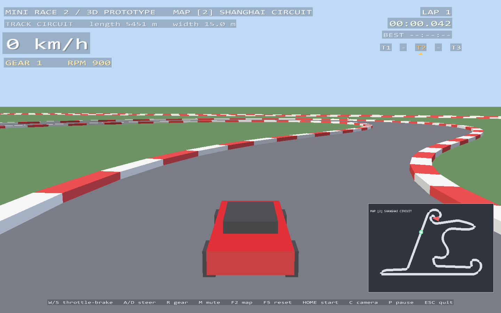
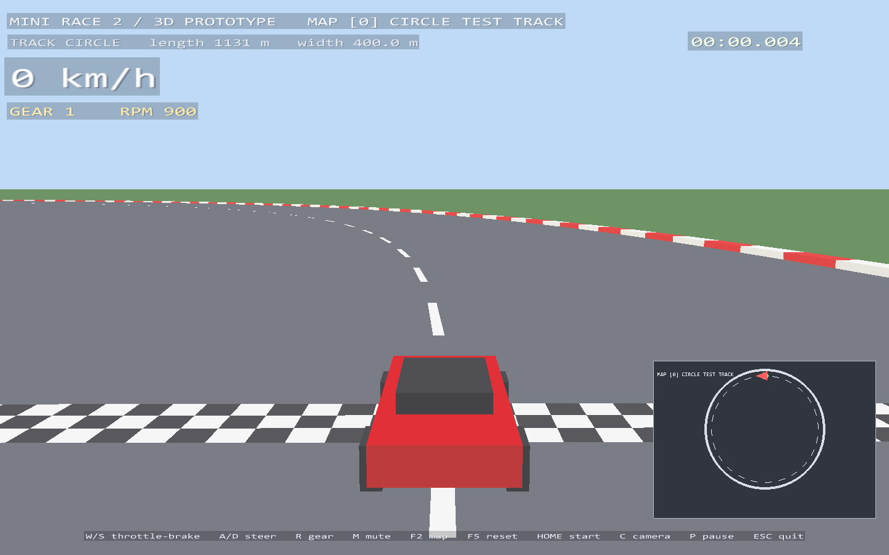
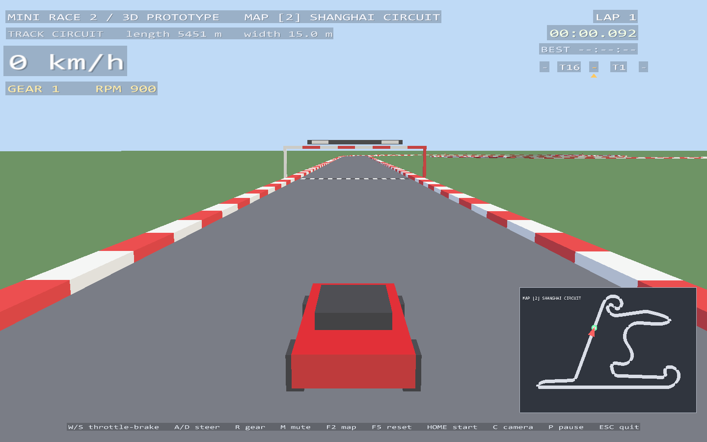

# 3D 显示原型（Panda3D）

这是一个**不改物理层**的 3D 显示原型：车辆动力学、碰撞、圈速仍然全部由
`scripts/minirace/` 负责，Panda3D 只读取 `Simulation`/`Track` 的状态来画场景。

'## 截图







## 运行'

需要 Python 3.8 + Panda3D；`01_Run.bat` 进入后选 `2`（默认是 2D）。批处理菜单为英文以避免代码页乱码：

```bat
python -m pip install panda3d
03_Run3D.bat
```

或直接：

```bat
D:\Programming\Python_dir_38\python.exe scripts\main3d.py
D:\Programming\Python_dir_38\python.exe scripts\main3d.py --map shanghai
```

截图/离屏渲染：

```bat
python scripts\main3d.py --map oval --screenshot data\3d_oval.png
```

## 操作

| 按键 | 功能 |
|---|---|
| `W` / `↑` | 油门 |
| `S` / `↓` | 刹车 |
| `A` / `←`、`D` / `→` | 方向 |
| `R` | D / R 换挡 |
| `M` | 静音 / 恢复声音 |
| `C` | 车尾追车 / 车头视角切换 |
| `F2` | 切换地图 |
| `F5` | 就近中心线复位 |
| `HOME` | 回起点 |
| `P` | 暂停 |
| `ESC` | 退出 |

3D 原型的相机默认是**车尾追车**，`C` 切到**车头前视**；没有车内驾驶舱视角。

## 场景内容

全部从现有 `cfg/track_*.json` 的 `centerline / left_edge / right_edge / start` 生成：

### 路肩

- 截面：**高 0.4 m × 宽 1.2 m** 的方形长条砖；
- 内边贴着赛道边界，向**外侧**延伸 1.2 m；
- 红白相间，每段颜色长度最多约 5 m（超过 5 m 自动切段）；
- 物理碰撞仍在原来的赛道内边界，路肩和柱子的碰撞体积**不参与物理**。

### 弯心柱

- 直径 **0.24 m**、高 **2.0 m** 的圆柱（V3.14 起为原尺寸 ×2）；
- 上 1/3 红、中 1/3 白、下 1/3 红（下段藏在 0.4 m 路肩里）；
- **上海**：每个弯在曲率绝对值最大处（弯心）的内侧路肩上放 1 根；
- **椭圆**：每个弯的进弯/出弯之间沿内侧路肩均匀放 **8 根**（含两端）；
- **圆形试车场**：额外画出 Ø360 m 白色虚线参考圆，并在起点画黑白格（均为纯视觉）；
- 圆形试车场没有柱子。

### 起点

- **椭圆 / 上海**：起点处一座龙门架，横梁底部离地 **4 m**，红白横梁 + 深色标牌；
- 地面画黑白格起点线，格带有纵向宽度；
- 黑白格的**近边缘**就是真正的计时判定线（现有 `LapTimer` 的 `track.start` 平面），
  格子带沿行驶方向向另一侧延伸。物理判定没有被改动。

### 车辆

- 程序化车身 + 车轮，方便先验证视角和场景；
- 后续可以替换成 GLB/OBJ 车模；
- 倒挡/刹车/加速都由原有物理驱动。

## 代码位置

| 文件 | 作用 |
|---|---|
| `scripts/main3d.py` | 3D 原型入口（含离屏截图参数） |
| `scripts/minirace3d/app3d.py` | ShowBase 主循环、输入、相机、HUD |
| `scripts/minirace3d/scene.py` | 赛道、路肩、弯心柱、龙门架、起点线、车 |
| `scripts/minirace3d/geometry.py` | 程序化 mesh 工具（盒/圆柱/合并几何） |

## 3D HUD 与缩略图

- 右下角缩略图：**360×255（1.5×）**、深色面板、赛道轮廓、绿色起点、红色自车三角；
  3D 使用 render2d 的 y 向上坐标，已修正世界北向与上下镜像；
- HUD 使用 Consolas 等宽字体（和 2D 一致），数字变化不会跳动宽度；
- 相机 `C` 切换车尾追车/车头前视，车头视角已避开引擎盖；
- 右上角 LAP/TIME/BEST 下方：5 要素弯道窗口（中间橙色高亮 + 小三角）；
  圆形试车场没有弯道元素时自动隐藏。
- 逆行超过 1.5 s 后，屏幕中上部闪烁 `[WRONG WAY]`，每次进入显示相位响提示音；
  与 2D 使用同一个 `WrongWayMonitor`（阈值 120° / 1.5 s / 1 s 闪烁），圆形场地无判定。
- 声音：复用 2D 的 `minirace.audio.Audio`（发动机采样/换挡/撞墙/打滑），`M` 静音。

## 当前限制

- 物理仍是平面 2D，所以赛道在 3D 里是**平的**，没有坡度/路肩高低差；
- 车辆是程序化方块，没有悬挂、轮子转向/滚动动画、灯光/尾焰；
- 只有基础 HUD（速度/挡位/圈速/5 要素弯道窗口），没有 2D 版的完整仪表/摩擦圆；
- 未接入 AI 驾驶员（AI 后续仍走原 `Simulation`）；
- Panda3D 依赖只用于 3D 显示，不影响原来的 pygame 2D 运行和全部自检。
